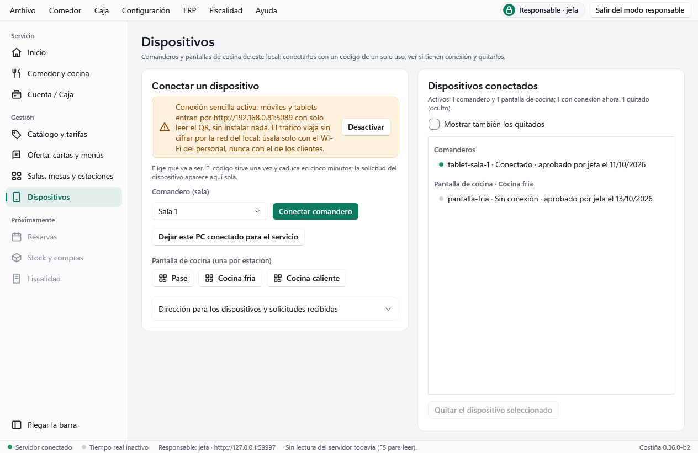
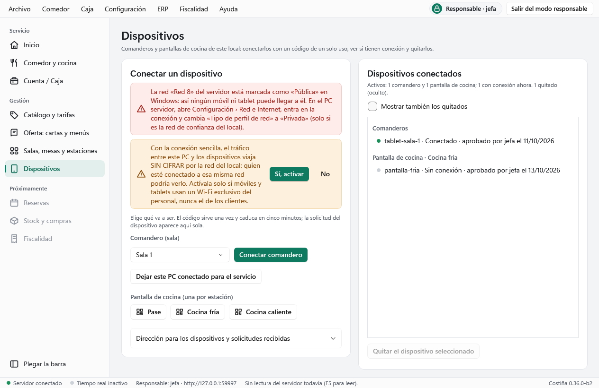

# B.2 — Conexión sencilla: móviles y tablets por la red del local sin instalar nada

Fecha: 2026-10-14. Rama `feat/b2-conexion-sencilla-lan` sobre `develop` (`bc751bb`). Decisión del promotor y **ADR-014**. Versión **`0.36.0-b2`**, **esquema v8**.

## El problema

El promotor instaló la 0.35.0-e3.2 en su PC. Desde Dispositivos generó el QR y, al leerlo con el móvil, este se quedaba en una página en blanco. El diagnóstico en su PC dio tres causas a la vez:

1. **La red de Windows estaba en «Pública».** La regla de firewall `Costina-HTTPS-LAN` solo abre el 5443 en redes privadas o de dominio, que es correcto, así que el móvil no llegaba al PC.
2. **El móvil no tenía instalada la raíz de la CA local** (D5.3), y el QR usaba el nombre `equipo.local`, que muchos Android no resuelven.
3. **`GET /ca.crt` devolvía 404 en una instalación real.** El instalador cierra `tls\` y solo dejaba al servicio leer `server.pfx`, así que el motor no veía `ca.crt` y no había forma de bajarla desde el propio PC.

El promotor decidió: «en el restaurante no podemos andar moviendo certificados ni instalando en dispositivos». Ver ADR-014.

## Qué cambia

**Motor**
- **Conexión sencilla** (`LanHttp.cs`):
  - Escucha HTTP propia en **5089** (`COSTINA_LAN_HTTP_PORT`; `0` = ninguna). En una instalación escucha en todas las interfaces; en el laboratorio, solo si se pide y solo en loopback. El 5088 sigue solo para el propio PC.
  - **Apagada por defecto.** Apagada, ese puerto solo contesta con una página que lo explica («Conexión sencilla desactivada… el responsable puede activarla»), antes de la identidad y de la PWA.
  - **Encendida**, sirve exactamente lo mismo que el HTTPS: identidad, permisos y freno de intentos. Solo atiende a direcciones privadas.
- **Esquema v8** (`upgrade-v8.sql`): `core.installation.lan_http`, con `GRANT UPDATE (lan_http)` para el rol de ejecución.
- **`POST /api/native/v1/installation/commands/lan-http-set`** `{ "enabled": true|false }`: solo el responsable (rol main), idempotente, auditada como `installation.lan_http_enabled` / `installation.lan_http_disabled`. Se aplica al momento, sin reiniciar el servicio. Al apagarla se cortan también las conexiones vivas por ese puerto, incluido el tiempo real (el WebSocket abierto no vuelve a pasar por la puerta), como al revocar un dispositivo.
- **`GET /api/native/v1/installation/network`** (solo main) devuelve:
  - el estado de la conexión sencilla;
  - las IPv4 privadas del equipo, con la sugerida: un adaptador con puerta de enlace que no sea virtual (se descartan VirtualBox, Hyper-V, VMware, WSL…);
  - las redes de Windows conectadas con su tipo (`public` / `private` / `domain`).
- `/diagnostics` añade `lanHttp`.
- **Servicio de Windows:**
  - regla de firewall nueva `Costina-HTTP-LAN`, solo en el puerto 5089 y solo en redes privadas o de dominio; se quita al desinstalar;
  - el servicio puede leer `tls\ca.crt` (nunca `ca.key`), así que `GET /ca.crt` vuelve a funcionar.

**Puesto principal (Inicio › Dispositivos)**
- Aviso en rojo si una red de Windows del servidor está en «Pública», con los pasos para pasarla a «Privada». El programa no cambia ese ajuste.
- Barra «Activar la conexión sencilla». Al pulsarla pide confirmación en un segundo paso, explicando que el tráfico va sin cifrar y que solo debe usarse con el Wi-Fi del personal. Mientras está activa, una barra ámbar lo recuerda y ofrece «Desactivar».
- Con la conexión sencilla activa, el QR lleva `http://IP:5089/app/#pair=CÓDIGO`, con la IP de la red del local, y dice que no hay que instalar nada. Por HTTP solo se admite una IPv4 privada escrita tal cual, nunca un nombre: podría resolverse fuera del local y, si el móvil ya visitó ese nombre por HTTPS, su navegador lo forzaría a HTTPS (HSTS). Al apagarla, la dirección `http://` deja de valer y vuelve a proponerse la `https://` de siempre.

**PWA**
- Por HTTP (`isSecureContext` falso) no pide almacenamiento protegido, que el navegador no puede dar. En su lugar dice: «Conexión sencilla (sin cifrar): así el navegador no deja instalar la aplicación ni proteger sus datos. Funciona igual…».

**Instalador:** el LÉEME explica la conexión sencilla y que la red de Windows debe ser «Privada».

## Qué NO cambia

- El dominio, los comandos operativos, la identidad (sesiones, dispositivos, tokens), el tiempo real y la PWA operativa.
- El HTTPS con CA local de D5.3 sigue igual y disponible.
- La regla de no desactivar nunca la validación TLS en los clientes. El WPF sigue aceptando solo `http://127.0.0.1` o `https://NOMBRE`; la conexión sencilla es solo para los dispositivos de la PWA.

## Diferido

- **Certificado público con dominio propio** (siguiente corte de transporte, ADR-014 punto 2): sin instalar nada y además cifrado. Necesita que el promotor decida el dominio y el servicio de emisión.
- Mostrar el estado de la conexión sencilla también en Inicio.
- Que `status` informe de la conexión sencilla.

## Comprobaciones automáticas

- `pairing_http.py` (laboratorio, puerto de pruebas + 11, solo loopback):
  - apagada, el puerto da 503 con la página explicativa en `/app/`, `/health`, `/session` y `claim`;
  - un dispositivo, un anónimo o una acción desconocida no pueden cambiarla;
  - el responsable la enciende: queda en la base y en la auditoría con `user:jefe`;
  - encendida, sirve la PWA y la sesión del dispositivo, sigue exigiendo identidad y permisos, y un móvil reclama su código por ella;
  - apagada otra vez, corta al momento, y un canal de tiempo real abierto por ese puerto se cierra (lo vio la verificación visual: sin este corte el móvil seguía con «Tiempo real activo»);
  - repetir una orden con la misma clave no cambia nada.
- `packaging_http.py`:
  - esquema v8 en todas las historias (instalación nueva, v1 → v8 en el sitio, restauración de una copia v1, copia de una base anterior (7) y rechazo de una más nueva (9));
  - la columna llega apagada y el rol de ejecución solo puede cambiar esa;
  - una instalación real (modo installation, rol de ejecución) la enciende y la apaga sin reiniciar.
- `service_checks.ps1` (CI, servicio real):
  - `ca.crt` legible por el servicio;
  - `GET /ca.crt` responde 200 e idéntico al fichero;
  - regla `Costina-HTTP-LAN` solo en el 5089 y nunca en redes públicas;
  - el 5089 da 503 hasta que el responsable la enciende;
  - la regla se retira al desinstalar.
- ClientChecks: direcciones `http://` válidas (IPv4 privada) y rechazadas (nombre, IP pública, loopback, 172.32…, puerto bajo, ruta, credenciales, consulta, IPv6).
- DesktopChecks:
  - QR con la IP del local (nunca la del adaptador virtual) y el texto «No hay que instalar nada»;
  - nombre rechazado por HTTP;
  - al apagarla, la dirección `http` se descarta;
  - aviso de red pública con el nombre de la red;
  - sin responsable no se puede encender, y encender pide confirmación en dos pasos;
  - un servidor sin conexión sencilla no pinta nada de esto;
  - capturas `devices.png` (activa) y `devices-simple-off.png` (red pública y confirmación al activarla).
- vitest: estado `plain-http` sin pedir nada al navegador.

## Verificación en local

- El motor de laboratorio (puerto 5090) se arrancó con la conexión sencilla en el 5101 y se probó en el navegador integrado:
  - apagada, `/app/` muestra la página «Conexión sencilla desactivada»;
  - encendida, el enlace del QR abre «Emparejar este dispositivo» con el código puesto;
  - al aprobar, el comandero entra solo («COMANDERO · Sala 1», «Tiempo real activo», mesas leídas).
- Al apagarla, el tiempo real seguía activo en el móvil ya conectado: de ahí el corte de las conexiones vivas, con su prueba (`pairing_http.test_14`).
- En este PC, los checks del WPF fallan también sobre `develop` limpio, en las aserciones de E3.2 que miran `IsVisible` de las miniaturas, ajenas a este corte. Las capturas y comprobaciones de B.2 se hicieron saltando solo esas aserciones en local, sin subir ese cambio. El CI ejecuta los checks completos.

## Capturas

## Para el promotor

1. Instalar encima `Costina-Setup-0.36.0-b2.exe`, del run «Native Windows installer» sobre `develop` tras el merge. Actualiza la base de v7 a v8, crea la regla de firewall del 5089 y da al servicio permiso de lectura sobre `ca.crt`.
2. Comprobar que la red de Windows está en «Privada» (Configuración › Red e Internet). Dispositivos avisa si no lo está.
3. Inicio › Dispositivos: «Activar la conexión sencilla» y luego «Sí, activar».
4. «Conectar comandero» y leer el QR con la cámara del móvil, en el **mismo Wi-Fi del local**. El enlace `http://192.168.…:5089/app/#pair=…` debe abrir la pantalla de emparejamiento con el código ya puesto. Dar un nombre y pulsar «Solicitar»; en el PC aparece la solicitud y se aprueba.
5. Desactivar la conexión sencilla y comprobar que el móvil deja de llegar (página «Conexión sencilla desactivada»). Activarla de nuevo para seguir.
