# C3e — Costiña Sala: «Mis mesas», abrir la mesa con sus alergias y «Servido»

Fecha: 2026-10-27. Rama `feat/c3e-costina-sala` sobre `develop` (`d6d7315`, `0.45.0-c3d`, con el PR #97 de la caché de la CI). Es la sección 4.4 del plan `docs/plans/2026-10-22-sala-y-cocina.md` (en adelante, `plan22`), aprobado el 22-10, con las secciones 5 a 10 y la «Revisión» de ese plan, y la mitad del camarero de la sección 4.6 de `docs/plans/2026-10-15-menus-carta-y-bodega.md`; todo bajado a pasos en `docs/plans/2026-10-27-c3e-costina-sala.md`. Objetivo visual: la maqueta aprobada `docs/plans/maquetas/2026-10-22-sala-y-cocina.html`, pestañas «1 · Sala · Mis mesas», «2 · Sala · Mesa», «5 · Sala · aviso» y «6 · Sala · servido»; para la hoja «Abrir mesa», que esa maqueta no dibuja, la pestaña «0 · Abrir mesa» de la del 15-10 (`docs/plans/maquetas/2026-10-15-comandero/abrir.png`). Versión **`0.46.0-c3e`**. Decisión escrita: **ADR-018** (`docs/ADR/ADR-018-mis-mesas-por-dispositivo.md`): «Mis mesas» por dispositivo y estación es presentación, no atribución a una persona.

Respuestas del promotor que fija este corte:
- **22-10 (`plan22:887`):** Costiña Sala enseña primero **«Mis mesas»** (las que abrió ese móvil y las de su estación de sala; cada móvil va emparejado a una estación de sala) **y después «Todas»**.
- **22-10 (`plan22:885-886`):** el camarero envía cada pase, recibe el aviso (la banda, la vibración en Android y su mesa en verde), sirve y toca **«Servido»**. Con la aplicación cerrada no hay aviso: el límite del iPhone está aceptado.
- **15-10, que siguen valiendo:** menú cerrado en Costiña; las alergias las decide cocina antes de enviar (E4e); tema claro, acento `#0E7A5F` y rojo solo para las alergias; nombres y nunca códigos; castellano con tildes; sin dinero en los móviles (ADR-007).
- **27-10, «Adelante»:** permiso para subir y mezclar C3e cuando la CI esté en verde (el de C3d no valía para este corte).

**Sin cambio de esquema (sigue la v8), de motor, de API, de CSP ni de la CI.** Cambian Costiña Sala (la PWA), lo que comparte con Costiña Cocina (el panel de estado y el envío de órdenes), sus pruebas, las capturas y la versión. El servidor ya daba todo lo que hace falta: quién abrió cada mesa y desde qué estación (desde E4e), el actor y la estación de cada móvil, y las alergias en la misma orden de abrir.

## Antes de instalar

- **No hay nada que hacer con los datos.** C3e no cambia cómo se guardan las mesas ni el esquema.
- **Los móviles ya emparejados siguen emparejados.** Después de actualizar el servidor, en cada móvil: recargar Costiña Sala (o cerrarla y abrirla), porque la página se pide siempre al servidor primero. Al abrir sale «Mis mesas». En las tablets, recargar también Costiña Cocina: cambian su panel de órdenes y sus avisos (más abajo, «En Costiña Cocina»).
- **Comprobación nueva: el PC y todos los móviles de Costiña Sala, en la misma estación de sala** (en Costiña, con una sola sala, una sola estación). Paso a paso:
  1. En el PC, «Entrar como responsable» y abre Dispositivos.
  2. En el grupo «Costiña Sala», cada fila dice su estación. La fila del PC, si está conectado como puesto, se llama «pc-» y el nombre del equipo (el nombre que Costiña le puso al tocar «Dejar este PC conectado para el servicio»). La suya y la de cada móvil tienen que decir la misma estación.
  3. Un móvil en otra estación: elige su fila, «Quitar «<nombre>»» y «Sí, quitar». Después, conéctalo otra vez como la primera vez: la estación buena elegida en el desplegable de Costiña Sala y «Conectar Costiña Sala · <estación>». Ponle el mismo nombre: así conserva las mesas que abrió.
  4. El PC en otra estación: lo mismo con su fila. Después, «Salir del modo responsable»: el PC avisa de que ya no está emparejado como puesto. «Entrar como responsable» otra vez y, en Dispositivos, con la estación buena elegida en el desplegable de Costiña Sala, «Dejar este PC conectado para el servicio».
  5. Al terminar, «Salir del modo responsable».
  - **Por qué:** una mesa abierta desde el PC como puesto guarda la estación del puesto, la elegida al dejarlo conectado. Con estaciones distintas (por ejemplo, la «Sala» que crea el botón «Crear la estación «Sala»» de Dispositivos cuando no hay ninguna, y otra creada después en Configuración), lo abierto en el PC **no sale en «Mis mesas» de los móviles ni les avisa**; sigue en «Todas».
  - **La estación de un dispositivo no se cambia:** por eso el que esté en otra se vuelve a conectar.
- **Las mesas abiertas en el PC con la contraseña del responsable** (una persona, sin estación) son «mías» en todos los móviles: no hay que hacer nada.
- **La guarda contra bajar de versión de E4e sigue.** Desde que `0.46.0-c3e` sirve los datos, el instalador de `0.45.0-c3d` se para con `SETUP FAILED`, sin copia y sin tocar nada. Volver atrás es lo de E4e: restaurar, en un equipo limpio y con el instalador anterior (`/RESTORE=`), la copia que el instalador de `0.46.0-c3e` hace justo antes de actualizar. Se pierde lo hecho después de actualizar.
- Siguen valiendo lo de C3b y E4e (no hay vuelta atrás instalando encima) y lo de C3c (un dispositivo emparejado con C3c tendría que emparejarse de nuevo en una versión anterior a C3c).

## Lo que notará la sala

### «Mis mesas» y «Todas»

Capturas: [«Mis mesas»](images/c3e/sala-mis-mesas-375x812.png), [las libres, al final](images/c3e/sala-mis-mesas-libres-375x812.png), [«Todas»](images/c3e/sala-todas-375x812.png) y [«Mis mesas» en una tableta en vertical](images/c3e/sala-mis-mesas-820x1180.png).

- **Al abrir Costiña Sala sale «Mis mesas»**, con su resumen («5 abiertas · 15 personas») y, debajo, dos pestañas: **«Mis mesas»** y **«Todas»**. La elegida se conserva al ir a una mesa y volver; al abrir la aplicación otra vez, sale «Mis mesas».
- **Qué mesa es «mía»:** la que abrió este móvil; la abierta desde otro móvil, o desde el PC, de su misma estación de sala; y la que no se sabe quién abrió (abierta antes de E4e, o en el PC con la contraseña del responsable). Mejor avisar de más que de menos. La ayuda lo dice: «Las que abriste tú y las abiertas desde los otros móviles de Sala 1. Arriba, las listas para servir; las libres, al final.». Si el móvil no sabe el nombre de su estación, dice «…de tu estación…».
- **En Costiña, con una sola estación de sala, todas las mesas ocupadas son «mías» en todos los móviles**, y todos reciben el aviso. «Mis mesas» se distingue de «Todas» cuando hay varias estaciones de sala.
- **Por la sala de cada mesa:** una sección por sala («Sala · 4 abiertas», «Terraza · 1 abierta»), en el orden de la configuración. Dentro de cada sala, primero las listas para servir, en verde y con el pase que está listo («Primero»), y después las demás, por el orden de las mesas. Una mesa ocupada que la configuración ya no lista va al final.
- **Al final, «Mesas libres»**: todas, agrupadas por la sala de cada mesa, con «Libre · 12 plazas» y «＋ Abrir mesa». No hay «mi sala»: el servidor no sabe de qué sala es cada estación (esquema; ver «Límites y diferido»).
- **Sin mesas mías:** «Ahora no tienes ninguna mesa abierta. Las de las otras estaciones están en «Todas».», y debajo, las libres.
- **«Todas» es el plano de siempre:** «Todas las mesas · 6 de 8 mesas ocupadas · 21 personas», con las pestañas de sala si hay dos o más. Las mesas de otras estaciones salen aquí, también en verde cuando están listas, pero sin banda.
- **La tarjeta es la misma en las dos pestañas.**
- **Todo esto es presentación, nunca permiso:** en «Todas» se ve todo, y en cualquier mesa se puede hacer lo que el servidor anuncie, también servir una mesa de otra estación.

### Abrir una mesa

Capturas: [la hoja](images/c3e/sala-abrir-mesa-375x812.png) y [la fila de la alergia](images/c3e/sala-abrir-mesa-alergia-375x812.png).

- Se toca una mesa libre (en «Mesas libres» o en «Todas») y sale la hoja «Abrir Mesa 6», con «Terraza · hasta 12 personas».
- **«¿Cuántas personas?»:** botones del 1 al 8, nunca más que la capacidad de la mesa; empieza en 2. Si la mesa admite más de 8, «Más…» enseña el paso a paso y el número, hasta la capacidad. Pasarse lo dice: «Esta mesa admite hasta 12 personas.».
- **«¿Qué van a comer?»:** el menú del día ya elegido, con su marca «Menú del día». «Otro menú…» enseña los demás; los menús con elección van dentro de «Más opciones».
- **«¿Alergias o intolerancias?»:** «Anotar alergia o intolerancia» añade una fila con «¿Quién?» (cada comensal o «Toda la mesa», sin ninguno elegido), «Tipo» (Alergia, ya elegida), «¿A qué?» («Por ejemplo, gluten») y «Gravedad» (Grave, ya elegida), y «Quitar». La fila es roja si la restricción alarma (una alergia, o cualquier grave) y ámbar si no. Con alguna, «Otra alergia o intolerancia» añade otra, hasta 30; las demás se anotan después desde la mesa.
- **Abajo, siempre a la vista:** «3 personas · Menú da casa · 1 alergia o intolerancia» y el botón grande «Abrir Mesa 6». Queda apagado mientras una fila esté a medias, con el primer problema escrito encima: «Elige para quién es cada alergia o intolerancia: un comensal o toda la mesa.», «Escribe a qué es cada alergia o intolerancia (2 caracteres o más).» o «Esa alergia o intolerancia ya está anotada para ese comensal.». Una fila vacía del todo no se mira.
- **Tres toques sin alergias:** la mesa, las personas y «Abrir Mesa 6». Con una alergia, tres más: anotar, quién y escribir a qué.
- **«Abrir» es una sola orden con todo:** personas, menú y alergias. Al confirmarse, sale la ficha de la mesa, con la alergia en la franja roja y el botón grande apagado: «Esperando la revisión de cocina».
- **Si el servidor no la abre** (otro puesto la abrió antes, el menú ya no se ofrece…) **o la orden no llega a salir**, la hoja se queda con sus filas. El motivo sale abajo, encima del botón «Abrir Mesa N», y también en el aviso de arriba de la pantalla: no hay que escribir otra vez las alergias. Si el menú ya no se ofrece, la hoja relee la lista y no deja ningún menú elegido: «Abrir» se apaga hasta que se elija otro. Si la orden queda sin confirmar, se vuelve a las mesas con la orden pendiente arriba, que ya lleva las alergias.

### La ficha de la mesa

Capturas: [la ficha](images/c3e/sala-mesa-375x812.png), [con el pase listo](images/c3e/sala-mesa-servido-375x812.png), [después de «Servido»](images/c3e/sala-mesa-servido-despues-375x812.png) y [en una tableta en vertical](images/c3e/sala-mesa-820x1180.png).

- **Arriba**, «Mesa 4 · Comiendo» y una sola línea: «Sala · Menú da casa · 4 personas». Debajo, la franja roja de las restricciones, como siempre, y «Carta y menús» y «Bodega y bebidas» en una fila corta, para que «Pases» empiece en la primera pantalla del móvil.
- **«Pases · 2 de 4 hechos»** (los hechos incluyen los omitidos):
  - lo servido y lo omitido, recogido en una línea: «✓ Entrante 15:39 ✓ Primero 15:58», «Postre omitido»;
  - cada pase sin terminar, con su número, su nota («Revisado por cocina», «Por revisar en cocina», «En cocina desde las …», «En el pase desde las 16:10») y la marca **«Siguiente»** en el que enviaría el botón grande, con el borde del acento; el listo, en verde;
  - **los platos agrupados**, como en Costiña Cocina y en el PC: «Merluza á galega (1 adaptada) × 4», con su estación por su nombre y su estado («Cocina caliente · Sin enviar»);
  - **las alergias aparte, bajo su plato y nunca atenuadas:** «Merluza á galega · Comensal 2 · ALERGIA frutos secos (grave) · Adaptado: sin almendra». En rojo si la restricción alarma, aunque no le afecte; en ámbar si no alarma y falta que cocina decida; y sin color, con un icono de información, en lo demás («Merluza á galega · Comensal 3 · Intolerancia lactosa (leve) · No le afecta: no lleva lactosa»). Mientras cocina no decide, la línea termina en «Por revisar en cocina». Una restricción de toda la mesa no se repite en cada línea: ya está en la franja roja.
- **El botón grande** es lo que anuncia el servidor, con una línea encima:
  - «Enviar siguiente pase · Principal», con «Cada estación lo recibe en su tableta al momento.» antes de servir nada, o «Último pase servido a las 15:58.» después;
  - apagado, con «Esperando la revisión de cocina», mientras cocina revisa una alergia;
  - **«Servido · Aperitivo»** con el pase listo, y encima «Listo en el pase desde las 16:10.». Antes decía «Marcar servido · …»; la orden pendiente y el PC siguen diciendo «Marcar servido».
- **Omitir un pase tiene su propia hoja:** en «Más opciones», «Omitir pase · Postre» abre «¿Omitir Postre?», con «Ese pase no se envía a cocina y queda omitido en la mesa.», el motivo (3 caracteres o más), «Volver» y «Omitir Postre», con borde de aviso y nunca en rojo. Es una orden.
- **«Más opciones»** se queda con lo demás que anuncie el servidor: pausar (con su motivo), omitir y lo que añada, por ejemplo «Iniciar servicio».

### Las alergias, desde la franja roja

Captura: [la hoja de alergias](images/c3e/sala-alergias-375x812.png).

- La cabecera de la franja lleva **«Cambiar»** si el servidor deja anotar o retirar, **«Anotar alergia o intolerancia»** si aún no hay ninguna, o **«Ver alergias»** en una mesa que ya no deja cambiarlas.
- **La hoja «Alergias e intolerancias»** escribe cada restricción entera (las de toda la mesa primero), roja si alarma y ámbar si no, con los platos a los que afecta y su estado: «Principal · Merluza á galega: Adaptado: sin almendra», «Postre · Tarta de Santiago: Por revisar en cocina». Un plato ya servido dice **«Servido a las 15:39»**, nunca una decisión (decisión 14). Si una decisión vale solo para algunos comensales de un plato, los nombra: «Comensales 1, 3 y 4».
- **«Retirar»** abre, dentro de su propia tarjeta, el motivo, «Volver» y el botón que retira. Es una orden.
- **«Nueva alergia o intolerancia»**, al pie, con los mismos campos que la hoja de abrir y el botón «Anotar alergia o intolerancia» (antes, «Anotar restricción»). Es una orden. Los problemas de formato se dicen con los mismos textos, también el de una alergia ya anotada.
- Cada orden cierra la hoja, y su resultado sale arriba.

### «Carta y menús»

- **El nombre de la mesa, a la vista:** «Mesa 3 · Sala · Carta». En el móvil solo salía en la flecha de volver, que no se lee, y ahora cada toque es una orden.
- **Menú con elección** (no es el caso de Costiña): una fila por comensal con los platos como botones. Lo elegido sale marcado y no se puede volver a mandar: elegirlo otra vez obligaría a cocina a revisarlo de nuevo. Cada toque es una orden.
- **Carta:** «Para quién» y «Cantidad» arriba, y los platos como botones. Cada toque es una orden, y la cantidad vuelve a 1. Una línea lo recuerda: «Un toque pide 1 para toda la mesa.».
- **Sin desplegables.** Si el servidor deja elegir o pedir y el móvil no tiene los platos de esa mesa: «Los platos de esta mesa no están en este móvil: su menú o carta ya no se ofrece ahora. Elige o pide en el PC principal.».

### La banda «listo para servir», solo de «Mis mesas»

Capturas: [la banda en «Mis mesas»](images/c3e/sala-aviso-375x812.png) y [sobre la ficha de otra mesa](images/c3e/sala-aviso-otra-mesa-375x812.png).

- **La banda de C3c avisa solo de las mesas de «Mis mesas»**, en las dos pestañas y en cualquier pantalla: «Mesa 5 · Aperitivo listo para servir», «El pase lo validó a las 16:10», «Servido · Aperitivo», «Ver mesa» y «Visto». Vibra en Android como en C3c: una vez por pase, con la página a la vista y después de un toque. En la sala no suena nada.
- **Una mesa de otra estación lista** se pinta en verde en «Todas», sin banda y sin vibración.
- **Con la ficha de esa misma mesa a la vista, la banda no la repite:** su botón grande ya es «Servido · Aperitivo». En «Carta y menús» o en «Bodega y bebidas» de esa mesa sigue saliendo, y la de las demás mesas sale siempre.
- La banda no tapa la flecha de volver ni el botón grande de la pantalla de debajo.

### Si el servidor rechaza una orden

Los rechazos que antes decían «El servidor rechazó la orden (código)» tienen ya su texto:
- «Esa mesa ya está ocupada: otro puesto la abrió antes. No se ha abierto otra vez.»
- «Ese menú o carta ya no se ofrece ahora. Se ha vuelto a leer la lista: elige otro.»
- «Ese comensal no está en la mesa. No se ha aplicado nada.»
- «Esa alergia o intolerancia ya estaba anotada para ese comensal. No se ha aplicado nada.»
- «Falta que algún comensal elija plato: elígelo en «Carta y menús».»
- «Ese pase no tiene platos pedidos: pide alguno en «Carta y menús» u omítelo.»
- «Ese pase ya se envió a cocina.» y «Ese pase aún no está listo.»
- «Ese menú aún no se puede abrir: avísalo en el PC principal. No se ha abierto la mesa.»
- «Esa mesa ya no está activa: se ha quitado en el PC principal. No se ha abierto.»
- «El servidor no admite esos datos: vuelve a leer la mesa y revísalos. No se ha aplicado nada.»

Son comunes: Costiña Cocina los dice igual si le llegan, y en «Bodega y bebidas» una línea de la ronda rechazada por un comensal que no está o por datos que el servidor no admite dice el texto nuevo (decisión 15).

### En Costiña Cocina: la orden de otra instalación

Costiña Cocina monta el mismo panel de estado y envía las órdenes igual que Sala, así que en sus tablets también cambia:
- **«ORDEN DE OTRA INSTALACIÓN»** dice qué orden era (por ejemplo, «Marcar servido · Primero · Mesa 7») y avisa: «Se hizo con otra instalación del servidor (reinstalado o restaurado en otro equipo). Este servidor solo puede decir si a él le consta. Antes de descartarla, comprueba en el PC principal si se aplicó.».
- **Se sigue pudiendo «Preguntar al servidor si la aplicó»** (un servidor restaurado puede conocerla) y «Descartarla». Si no le consta: «A este servidor no le consta esa orden. Eso no dice nada de la instalación donde se hizo: compruébalo en el PC principal antes de descartarla.». Antes decía «Al servidor no le consta esa orden.», que invitaba a descartarla y repetirla. Una orden pendiente del propio servidor sigue diciendo eso.
- **Los textos nuevos de rechazo**, los de arriba.
- Nada más: lo demás de Costiña Cocina no cambia, y sigue diciendo «Por revisar en el pase».

### Criterios de «más intuitivo» (sección 2 del plan del 22-10)

| Tarea | Antes (C3d) | Ahora |
|---|---|---|
| Ver las mesas propias | todas las mesas del local | «Mis mesas» primero, con las listas arriba; «Todas», a un toque |
| Abrir una mesa libre | la mesa, las personas y «Abrir»: 3 toques | igual: las libres van al final de «Mis mesas» |
| Abrir con una alergia | abrir y después, en la ficha, «Anotar restricción»: **dos** órdenes | en la misma hoja: anotar, quién y a qué; **una** orden |
| Saber qué lleva el pase siguiente | una línea por comensal y plato | los platos agrupados y las alergias aparte, en rojo si alarman |
| Servir desde la ficha | «Marcar servido · Principal» | «Servido · Principal», con «Listo en el pase desde las …» encima |
| Omitir un pase | el motivo en un campo compartido de «Más opciones» | su propia hoja, con el motivo y «Omitir Postre» |
| Retirar una alergia | «Retirar · … (con motivo)» en «Más opciones», con el mismo campo compartido | «Cambiar» › «Retirar» en su tarjeta, con el motivo al lado |
| Elegir o pedir platos | desplegables | un botón por plato: un toque, una orden |
| Enterarse de un pase listo | la banda de todas las mesas | la banda de «Mis mesas»; las demás, en verde en «Todas» |

## La regla nueva: «Mis mesas» por dispositivo y estación → ADR-018

Hasta C3d, Costiña Sala enseñaba todas las mesas del local, y la banda de C3c avisaba de todas. C3e añade **«Mis mesas»**, y la regla queda escrita en **ADR-018** (`docs/ADR/ADR-018-mis-mesas-por-dispositivo.md`):
- **Una mesa es «mía»** si la abrió este dispositivo (quién la abrió es el actor que da el servidor, `device:Móvil de Ana`, comparado tal cual y nunca rehecho con el nombre guardado en el móvil), si se abrió desde su misma estación de sala (por su código, que no cambia al renombrarla) o si no se sabe quién la abrió.
- **Es presentación, nunca permiso.** En «Todas», cualquier móvil de sala ve todas las mesas y hace lo que el servidor le anuncie. El servidor no filtra «Servido» por estación de sala: lo que prueba la historia de navegador es el filtro del móvil.
- **No es atribución a una persona.** El nombre del dispositivo no es único (el PC solo avisa de un nombre repetido, F12), y la auditoría sigue siendo el actor `device:<nombre>`. Atribuir a un camarero es E5 y el Hito 7, con su propio ADR.
- **La banda avisa solo de «Mis mesas».**
- **Un requisito de uso:** en un local con una sola sala, el puesto del PC y todos los móviles de sala van en la misma estación de sala. Si no, lo abierto en el PC como puesto no sale en «Mis mesas» ni avisa («Antes de instalar»).
- **No hay «mi sala»** mientras la estación no sepa de qué sala es, que es esquema.

**Por qué:**
- **Lo pidió el promotor el 22-10:** primero lo suyo y después todo.
- **Mejor avisar de más que de menos:** una mesa sin dato de quién la abrió avisa a todos los móviles.
- **Sin tocar el motor:** E4e ya guarda quién abrió cada mesa y desde qué estación, y `/session` da el actor y la estación de cada móvil. Mientras dure su credencial, el actor y la estación de un móvil no cambian: el motor no tiene ninguna ruta que los cambie, y volver a emparejarlo monta la pantalla de nuevo.

## Qué cambia

### Lógica sin DOM (vitest)

Todo es presentación de la lectura del tablero: nada habilita nada. Un botón existe solo porque el servidor anuncia su acción, ya filtrada por papel y estación (D3.1, E4e).

- **`pwa/types.ts`:** `Dining` gana `openedBy` y `openedStation`, opcionales: el servidor los omite cuando no los sabe, y la guarda de dinero no los mira.
- **`pwa/sala.ts`:** `Who` (`{ actor, station }`, sin importar `Session`), **`isMine`** y **`mineEntries`**, lo que lee la banda: filtra y conserva el orden y las mismas entradas (F01). Un `openedBy` o un `openedStation` ausente o vacío se toma como desconocido, así que la mesa es «mía»; una estación nula nunca coincide. `ReadyWatch` no cambia y no hace falta `rescope`.
- **`pwa/mesas.ts`** (nuevo) solo ordena lo que ya da `floorRooms`, que no cambia: `mineSections` (las ocupadas mías por la sala de cada mesa, primero las listas, con el mismo `tileState` que pinta el verde, y «Otras mesas ocupadas» al final), `freeSections`, `mineSummary` («7 abiertas · 19 personas»), `mineRoomLabel`, `freeLabel` («Mesas libres · 3 libres»), `mineHint(stationName)` y los títulos.
- **`pwa/abrir.ts`** (nuevo):
  - `paxChoices` y `paxLimit`: del 1 al 8 sin pasar de la capacidad; «Más…» solo por encima de 8 o sin capacidad conocida, y entonces el límite de siempre, 40. `initialPax` y `paxProblem`;
  - `offerGroups`: la propuesta, «Otro menú…» y «Más opciones»;
  - `KINDS` y `SEVERITIES`, que salen de `TableCard.vue`; `RestrictionDraft` y `newDraft` (borradores en memoria, como la ronda de Bodega y como el PC); `guestChoices`; `MAX_DRAFTS` (30, como el PC);
  - `draftProblem`: los tres textos de formato del PC, en su orden, y la duplicada que rechazaría el servidor, comparada letra a letra sin mirar mayúsculas, como él;
  - `openDescription` («Abrir Mesa 5 para 3 personas con 1 alergia o intolerancia») y `openSummary`;
  - **`openRequest`:** **una** orden `POST /dining/services` con `{ tableId, pax, offerId, menuId, restrictions }`. Sin filas, el cuerpo de antes, que entiende también un servidor anterior. Con un problema de formato no hay orden: una fila sin comensal nunca sale como «Toda la mesa».
- **`pwa/pases.ts`** (nuevo): `timeline` (la línea de servidos y omitidos, y cada pase sin terminar con sus platos agrupados por la regla común de `cocina.ts`, su nota y «Siguiente»), `courseNote`, `chooseRequest` y `addDishRequest` (una orden `choose` o `add-dish` por toque, con la versión leída, F01; la cantidad, de 1 a 20, como el servidor) y `allergyList`. Sustituye la regla propia de Sala de `TableCard.vue`, que contaba como excepción un «No le afecta» y una restricción de toda la mesa sin decisión, la repetía en cada línea y no agrupaba nada.
- **`pwa/ficha.ts`:** el botón grande dice «Servido · Principal» (`BUTTON.serve`). `fireNextCourse` da el pase que enviaría el botón, para su texto y para «Siguiente». `barNote` da la línea encima del botón.
- **`pwa/cocina.ts`:** `exceptionLine` gana un segundo parámetro, aditivo, con el texto de lo pendiente: Sala dice «Por revisar en cocina» y Cocina sigue con «Por revisar en el pase».
- **`pwa/commands.ts` y `pwa/labels.ts`:** `REJECTIONS` gana once textos (los de arriba; el de `offer_unpriced` no copia el del PC, que habla de dinero). La orden `foreign` guarda su descripción, `reconcile` da el «no consta» de otra instalación y `foreignAdvice` va junto a `otherActorAdvice`.

### La tabla común `kitchen-cases.json`, con un lector más

- `dotnet/tests/fixtures/kitchen-cases.json` no cambia. Ahora la leen **tres** pruebas: ClientChecks (contra `DishGroups` del PC), `tests/cocina.test.ts` (Costiña Cocina) y `tests/pases.test.ts` (la ficha de Costiña Sala). **Romper un caso rompe las tres.**
- La ficha de Sala agrupa y aparta igual que Cocina y que el PC. Solo cambian dos palabras: «Por revisar en cocina» y el nombre del plato delante de cada línea de excepción.

### Pantallas

- **`BoardView.vue`:**
  - la pestaña (`'mine' | 'all'`) vive en memoria, junto a la sala elegida;
  - el segmento «Mis mesas» / «Todas» sigue el patrón de pestañas de ARIA: flechas, Inicio y Fin, solo la elegida entra con el tabulador y el contenido es su panel;
  - la banda lee `mineEntries` y deja fuera la mesa cuya ficha está a la vista;
  - `open` actúa según el resultado de la orden: confirmada, rechazada, sin confirmar o no enviada.
- **`MineList.vue`** y **`TableTile.vue`** (nuevas): la tarjeta sale de `FloorGrid.vue` y es la misma en las dos pestañas, pintada una sola vez (`v-if`). La libre dice «Libre · 12 plazas» y «＋ Abrir mesa» si el servidor anuncia abrir; la lista dice qué pase está listo.
- **`OpenTable.vue`**, rehecha sobre `abrir.ts`.
- **`TableCard.vue`:** la cabecera de una línea, las entradas compactas en el móvil, `CoursesTimeline.vue` (nueva), la línea encima del botón grande, «Cambiar» en la franja y dos hojas nuevas, `SkipSheet.vue` y `AllergySheet.vue`. Se retiran la regla propia de excepciones, el alta plegada dentro de la franja (un `
`) y «Retirar» de «Más opciones».
- **`DishPanel.vue`**, sin desplegables. **`StatusPanel.vue`**, con la descripción y `foreignAdvice` en la orden de otra instalación, en las dos aplicaciones.
- **`style.css`:** un bloque de Costiña Sala con sus prefijos (`board-`, `open-`, `fc-`, `carta-`), objetivos de 48 px, el acento en los botones, el verde de listo, el ámbar de lo pendiente y el rojo solo para lo que alarma. Sin estilos en línea: la CSP no cambia. Se retiran las reglas que ya no usa nadie (`.declare`, `.cpass`, `.cp-*`, `.preps`, `.prep-line` y `.guest-row`).
- **`data-testid`:**
  - nuevos en las mesas: `board-scope-mine`, `board-scope-all`, `mine-summary`, `mine-hint`, `mine-empty`, `mine-room-<sala>`, `mine-free` y `free-room-<sala>`;
  - en la hoja de abrir: `pax-more`, `offer-more`, `open-allergies`, `open-add-restriction`, `open-row-<n>` (desde 1), `open-guest-<n>-<comensal|all>`, `open-kind-<n>-…`, `open-severity-<n>-…`, `open-remove-<n>`, `open-summary`, `open-problem` y `open-rejected`;
  - en la ficha: `courses-served`, `served-<pase>`, `course-note-<pase>`, `course-next`, `dish-<pase>-<n>`, `bar-note`, `restrictions-open`, `carta-table`, `skip-sheet`, `skip-cancel`, `do-skip-confirm`, `skip-problem`, `allergy-sheet`, `allergy-close`, `allergy-none`, `allergy-<restricción>`, `allergy-problem`, `remove-restriction-<id>`, `remove-cancel`, `declare-guest-…`, `declare-kind-…` y `declare-severity-…`;
  - en la carta: `carta-unknown-offer`, `choose-<pase>-<comensal>`, `chosen-…`, `do-choose-<pase>-<comensal>-<n>` y `do-add-dish-<pase>-<n>` (desde 0), `carta-for`, `carta-guest-…`, `carta-minus`, `carta-qty`, `carta-plus` y `carta-tap`; en el panel, `blocked-description`, en las dos órdenes bloqueadas (la de otro nombre y la de otra instalación);
  - siguen `table-<id>`, `tile-state`, `tile-alert`, `do-wait`, `do-serve-<pase>`, `do-skip-<pase>` (ahora abre la hoja), `do-remove-restriction-<id>` y `do-declare-restriction` (ahora dentro de la hoja de alergias); `prep-<id>` queda solo para las líneas de excepción;
  - cambian de forma `do-choose-<pase>-<comensal>` y `do-add-dish-<pase>`: ganan el índice del plato (`-<n>`, arriba);
  - desaparecen `prep-review` y el `action-problem` de la hoja de abrir y de la carta; con los desplegables de la carta se van sus `id` y `name` (`choice-…`, `dish-…`, `dish-qty-…`), que no eran `data-testid`.

### Pruebas de navegador: el proyecto `sala-vertical`

- **`playwright.config.ts`:** proyecto `sala-vertical`, 820 × 1180, táctil, Chromium, que corre solo `mesas.spec.ts`. Esa historia sale del proyecto `desktop` y corre también en `mobile`. Playwright pasa de 29 a 31 pruebas. Sin `E2E_BASE` ya no hay dirección por defecto (decisión 27).
- **`e2e/support.ts`:** `TAGS` gana `sala-vertical`; `salaTable()` da M5 a `mobile` y a `sala-vertical`, que corren uno detrás de otro; `recordVibrations`, `vibrations`, `finishAndRelease` y `kitchenValidates` pasan aquí desde `banner.spec.ts`; y tres ayudas por API: crear una estación de sala, desactivarla y revocar un dispositivo.
- **`e2e/mesas.spec.ts`**, nueva, contra el motor real (ver «Comprobaciones automáticas»).
- **Historias que cambian:** `board.spec` mira los platos agrupados («Cocina caliente · Por empezar» › «Cocina caliente · 0 de 3 listas») y toca «Todas» antes de las pestañas de sala; `commands.spec` comprueba `pax-2` y el resumen, y el pase servido en la línea de servidos; `banner.spec` solo importa las ayudas movidas. `drinks`, `kitchen`, `install` y `pairing` no cambian: sus mesas las abre el token principal, una persona sin estación, y son «mías».

## Decisiones tomadas al construir, para revisar

Pequeñas. Cualquiera se cambia si el promotor lo prefiere.

**Las doce del plan, construidas así:**
1. **La ayuda de «Mis mesas» es la de la maqueta.** No nombra las mesas abiertas en el PC con la contraseña del responsable, que también son «mías». Las abiertas en el PC como puesto lo son solo si el puesto está en la misma estación que el móvil («Antes de instalar»).
2. **Las listas para servir van arriba dentro de cada sala**, como la maqueta, y no arriba de todo. En Costiña, con una sola sala, es lo mismo.
3. **«Mis mesas» dice «abiertas»**, como la maqueta. «Todas» conserva las palabras del Comedor del PC: «6 de 8 mesas ocupadas».
4. **Personas: del 1 al 8 y «Más…»**, no del 1 al 6 de la maqueta del 15-10. Nunca más que la capacidad de la mesa.
5. **Cada fila es una alergia con su comensal**, como el PC y la maqueta del 15-10. No hay una fila fija por comensal: con 8 personas serían 8 filas vacías.
6. **«Abrir» queda apagado mientras una fila esté a medias.** Una fila vacía del todo no se mira.
7. **Si el servidor rechaza la apertura, la hoja se queda con sus filas**, para no escribir otra vez las alergias.
8. **Los platos agrupados van en la tarjeta «Pases» de la ficha**, como la maqueta del 22-10. «Carta y menús» se queda para elegir y pedir.
9. **Todo pase sin enviar enseña sus platos con sus líneas de alergia.** La maqueta resume los que van después del siguiente.
10. **El título sigue siendo «Pases · 2 de 4 hechos»**, que incluye los omitidos, y no «servidos».
11. **Cada plato agrupado lleva el nombre de su estación**, que la maqueta no pinta: el mismo nombre en dos estaciones son dos platos.
12. **Con una orden de otra instalación se sigue pudiendo preguntar**, con el aviso honesto, en lugar de quitar el botón.

**Al construir:**

13. **`offerGroups` propone también un menú con elección** si es el primero vigente, como E4d y el PC, y no lo repite en «Más opciones». El plan decía que los menús con elección van solo en «Más opciones»: en ese caso las dos reglas chocan, y gana la del PC. En Costiña, con menú cerrado, no pasa.
14. **En la hoja de alergias, un plato de un pase servido dice «Servido a las …»** (o «Servido», si falta la hora del servidor), nunca una decisión. El servidor pone cada restricción también en lo ya servido, pero no lo marca para revisar, y las restricciones no tienen hora: no se puede saber si la decisión de un plato servido era para esta restricción. El coste: un plato revisado para esa misma alergia y servido después tampoco enseña su decisión en la hoja. Un plato sin decisión ni revisión pendiente (una mesa abierta antes de E4e) dice su estado, por ejemplo «Por empezar».
15. **«Bodega y bebidas» enseña dos de los textos nuevos:** `bodega.ts` (`roundProblem`) busca en la misma lista, así que una línea de la ronda rechazada con `invalid_request` o con `invalid_guest` dice ya «… No se ha aplicado nada.» en lugar de «El servidor rechazó la ronda (…). No se ha añadido nada.».
16. **`abrir.test.ts` lee el código del servidor:** los registros `OpenRequest` y `RestrictionRequest` de `DiningOperations.cs` y los enum de tipo y gravedad de `Restrictions.cs`, para que los nombres sigan alineados. Si el servidor cambia un campo, falla la prueba de la PWA. Compara las claves sin mirar su orden. Es un acoplamiento nuevo: hasta ahora vitest solo leía `dotnet/tests/fixtures`.
17. **«1 libre», en singular.** La maqueta escribe siempre «libres».
18. **Un `openedBy` o un `openedStation` vacío se toma como desconocido**, así que la mesa es «mía»: mejor avisar de más.
19. **La hoja de abrir se queda abierta con sus filas tras un rechazo, y también si la orden no llegó a salir** (no se pudo guardar, u otra orden ocupaba su sitio). El motivo sale encima de «Abrir» (`open-rejected`), hasta el siguiente intento o hasta dejar la hoja. Tras «Ese menú o carta ya no se ofrece ahora», no queda ningún menú elegido: un segundo toque nunca abre con un menú que el camarero no eligió. Si el camarero deja la hoja mientras la orden va, no se le mueve de donde esté.
20. **Una tarjeta lista dice qué pase está listo** («Primero»), como las pestañas 1 y 5 de la maqueta.
21. **Las libres dicen «Libre · 12 plazas»**, sin pastilla, como la maqueta.
22. **La banda deja fuera la mesa cuya ficha está a la vista**, para que «Servido» no salga dos veces (maqueta 6, «Al tocar «Ver mesa»»). En «Carta y menús» y «Bodega y bebidas» de esa mesa sigue saliendo. Por eso, en `mesas.spec`, el móvil A vuelve a «Mis mesas» para ver la banda y después toca «Ver mesa».
23. **«Retirar» abre el motivo dentro de su propia tarjeta**, con «Volver» y el botón que retira, en lugar de un motivo común al final de la hoja, lejos del botón.
24. **El paso a paso de las personas solo sale tras «Más…»** (o si ya se eligieron más de 8), y nunca en una mesa de 8 o menos. «Más…» es un botón ancho bajo los números: con nueve en una fila, cada uno tendría unos 31 px. Con 7 u 8 botones, dos filas de cuatro en el móvil.
25. **Abrir con una alergia lleva más de tres toques:** los tres de siempre (la mesa, las personas y «Abrir») y, aparte, anotar, quién y escribir a qué. Sin alergias, tres.
26. **El segmento «Mis mesas» / «Todas» sigue el patrón de pestañas de ARIA:** el lector de pantalla las anuncia con su panel, las flechas cambian de pestaña y solo la elegida entra con el tabulador.
27. **`playwright.config.ts` ya no cae en `127.0.0.1:5088` sin `E2E_BASE`.** Ese puerto es el de la instalación real, y las historias abren, terminan y liberan mesas: ahora, sin `E2E_BASE`, la primera llamada falla y no se toca nada. Además, la limpieza de `mesas.spec` y de las capturas solo termina lo que abrió esa ejecución. Ninguna prueba de este corte ha tocado la instalación real.
28. **El título y el resumen de «Mis mesas» van en la cabecera, y el resumen siempre en su propia línea:** las dos pestañas tienen la misma cabecera y el segmento no se mueve bajo el dedo al cambiar.
29. **«Mesas libres» no sale si no hay ninguna**, y sin mesas activas no sale «Mis mesas» (no se junta con «No hay mesas activas»). El subtítulo de sala bajo «Mesas libres» sale aunque haya una sola sala. Desde 700 px, el segmento no pasa de 30rem de ancho.
30. **En la hoja de abrir:** «Abrir» también se apaga con un problema en las personas o sin menú; «Más opciones» sale después de «Otro menú…» (si los demás son todos con elección, «Otro menú…» los abre directamente); las filas se pueden escribir con una orden sin confirmar, y solo «Abrir» espera, como la ronda; sin capacidad conocida, «Elige cuántas personas (1 a 40).»; si la capacidad llega después de abrir la hoja y no se han tocado las personas, el número inicial se recalcula; bajo el nombre de cada menú, «Platos sueltos de la carta» solo en una carta (antes lo decía también un menú sin pases); al añadir una fila, se ve y el foco va a su «¿Quién?»; «¿A qué?» admite hasta 80 caracteres; sin filas, la ayuda de la maqueta del 15-10: «Se anota por comensal y viaja con la apertura…».
31. **Las líneas de excepción en la ficha:** rojas si la restricción alarma, ámbar si no alarma y falta decidir, y sin color, con un icono de información, si no alarma y ya está decidida. En Costiña Cocina, esa última va en ámbar. El nombre del plato va delante de cada línea, como en la maqueta.
32. **En los pases:** «Siguiente» sale solo cuando el servidor anuncia enviar el siguiente pase, y ocupa el sitio de la marca «Sin enviar» del pase; los platos siguen diciendo «Sin enviar», como en la captura de la ficha. Si el pase tiene otro estado, como «Falta elegir plato», sale también, en azul. «Revisado por cocina», solo en un pase sin enviar; un menú con elección o un pase de carta sin enviar conserva su nota de siempre («Han elegido 1 de 4 personas»); «Por revisar en cocina», siempre que haya algo pendiente, también en uno listo; en cocina, «En cocina desde las … · n de m platos listos»; sin las horas del servidor, «Listo en el pase.». Un pase omitido no vale como servido. «Postre omitido» va tal cual, así que un pase en plural dice «Aperitivos omitido».
33. **La línea encima del botón grande es siempre gris.** La maqueta pinta en verde la de después de servir; hacerlo exigiría leer el texto para darle color.
34. **«Cambiar», «Anotar…» y «Ver alergias» son un solo botón**, solo en la ficha (no en «Carta y menús» ni en «Bodega y bebidas»). No es una orden: se puede abrir con una orden sin confirmar, y dentro los botones de orden están apagados. La hoja de omitir se cierra sola si el servidor deja de anunciar ese omitir. La de alergias esconde «Retirar» o el alta cuando dejan de anunciarse, y se cierra sola solo cuando ya no queda nada que enseñar (ninguna alergia y nada que anotar).
35. **En «Carta y menús»:** el plato ya elegido queda apagado; lo elegido se reconoce por el nombre, porque el plato no guarda otro dato, y uno elegido que ya no está en la oferta se escribe sin botón marcado; el aviso de platos que no están en el móvil sale también si un pase anunciado no tiene platos en este móvil; «Para quién» y «Cantidad» son uno para toda la carta; cada comensal de un menú con elección lleva sus restricciones (las de toda la mesa no, que están arriba), con el punto ámbar si ninguna alarma.

**Diferencias con la maqueta que se dejan así:**
- **«Mis mesas»:** el resumen va debajo del título y no a su lado (decisión 28). Arriba sigue la fila de la conexión de C3c («Tiempo real activo · Leído hace 0 s») en lugar de «En línea» en la cabecera.
- **La franja roja no lleva la frase de la maqueta** «Cocina revisó todo su menú antes de enviar: …»: lo que decidió cocina está bajo cada plato.
- **Bajo cada plato:** «(1 adaptada)», en rojo, al lado del nombre, y debajo la estación y el estado; la maqueta pone «1 adaptada» debajo y no nombra la estación. La línea adaptada no lleva «Lo escribió cocina antes de enviar».
- **Un «No le afecta» de la restricción de un comensal tiene su línea**, que la maqueta no dibuja: es la regla común, la restricción de un comensal se escribe.
- **«Pases · 2 de 4 hechos»** (decisión 10), con el menú y su tipo debajo («Menú da casa · Menú degustación») en lugar de «Todos comen lo mismo».
- **La línea del botón grande no repite el pase**, que ya está en el botón («Listo en el pase desde las 21:19.»), y es gris también después de servir: «Último pase servido a las 21:21.» y no «Principal servido a las 21:21. El postre ya puede salir.».
- **La hoja de abrir:** del 1 al 8 en dos filas de cuatro y «Más…» debajo, a lo ancho; la del 15-10 pinta del 1 al 6 en una fila. La fila de una alergia es roja solo si alarma. El botón dice «Abrir Mesa 6», con el nombre.
- **La banda sobre otra pantalla se capturó sobre la ficha de otra mesa** y no sobre su bodega: el laboratorio no tiene vinos. En la pantalla no cambia nada.

**Revisión (27-10), lo que cambió tras las revisiones de lógica, aspecto y pruebas:**
- **La hoja de alergias** dejó de atribuir a una restricción nueva la decisión de un plato ya servido (decisión 14), y un plato sin decisión ya no sale sin estado.
- **Aspecto, comparado con las capturas de la maqueta:**
  - «Carta y menús» nombra la mesa;
  - la línea «Por revisar en cocina» de la hoja de alergias salía como un panel grueso, con el icono solo en una línea (chocaba con una clase común); ahora es texto ámbar con su icono;
  - en el móvil, «Carta y menús» y «Bodega y bebidas» en una fila compacta, de unos 64 px: «Pases» empieza en la primera pantalla;
  - un solo «Servido» en la ficha de la mesa lista (decisión 22), y «Retirar» con su motivo en la tarjeta (decisión 23);
  - el segmento ya no se mueve al cambiar de pestaña (decisión 28), y «Cambiar» queda en la línea del título de la franja;
  - la cabecera de la ficha, en una línea: las horas van en la línea del botón grande;
  - «Más…» y «Más opciones», abiertos, en gris neutro y no como una opción elegida;
  - «¿Para quién?», igual en la hoja de abrir y en la de alergias;
  - los platos de la hoja de alergias, con un punto neutro y no con una flecha que parecía tocable;
  - las libres, sin pastilla (decisión 21);
  - el rechazo de la apertura, a la vista y sin cambiar de menú solo (decisión 19);
  - el patrón de pestañas (decisión 26).
- **Pruebas:** cada fichero nuevo de vitest tiene su rojo con una copia rota a propósito, no solo el de un módulo que falta; «Visto» y `barNote` tienen un caso que ve su regla; las claves del cuerpo de abrir se comparan sin orden; `pases.test.ts` comprueba que importa la regla de `cocina.ts`; y `mesas.test.ts` y `pases.test.ts` buscan las palabras de caja en todo el fichero.
- **`mesas.spec`:** la comprobación de que B se ha tocado no podía fallar, porque en Chromium cada `page.evaluate` de Playwright vale como un gesto del usuario. Ahora comprueba las dos condiciones de la vibración (la página a la vista y activada) y lo dice, sin atribuirlo al toque. La banda y la vibración de B van en una sola comprobación, con su ejecución en rojo («En rojo antes de su arreglo»). La limpieza solo termina lo que abrió A (decisión 27).
- **Capturas:** «Abrir mesa» desde arriba, más una de la fila de la alergia; la Mesa 5 con su alergia y la línea adaptada; el menú de ensayo del laboratorio, renombrado en el navegador a «Menú da tempada»; y dos nuevas, la banda sobre la ficha de otra mesa y la ficha después de «Servido».

**Un punto para el promotor, sin cambiar código:** la captura [`sala-mesa-820x1180.png`](images/c3e/sala-mesa-820x1180.png) enseña el pie de C3b de «Lo que lleva la mesa», «Los importes solo se ven en Caja.» (`HAD_FOOT`, `pwa/bodega.ts`, con las palabras de ADR-007). En el móvil queda bajo la parte visible. `checkScreen` no lo para porque su lista (`MONEY_WORDS`, `e2e/support.ts`) no incluye «importe», «caja» ni «euro», y añadirlas haría fallar textos de C3b que ya están aprobados. Decide el promotor si ese pie se queda.

**En las capturas, la Mesa 2 es «mía» por la regla:** la abrió `pwa_http` con el token principal de las pruebas, una persona sin estación, como el responsable en el PC, así que no se sabe desde qué estación se abrió y sale en «Mis mesas» de todos los móviles (decisión 1 y ADR-018). No es un error de las capturas.

## Qué NO cambia

- **El motor, el esquema (v8), la API, `grants.sql` y la CSP.** `openedBy` y `openedStation` solo se leen. Las tablas comunes `floorplan-cases.json`, `vocabulary-cases.json` y `kitchen-cases.json` no cambian: una prueba más lee la última.
- **El servidor decide los botones** (D3.1). «Mis mesas», los grupos y los colores son presentación, nunca permiso. Un móvil de sala sigue pudiendo servir cualquier mesa que vea en «Todas», si el servidor se lo anuncia.
- **Una sola orden incierta durable, una por gesto** (D6.3, D6.7):
  - «Abrir mesa» con sus alergias es **una** orden `open`;
  - «Servido», omitir, retirar y anotar son una orden cada uno;
  - elegir y pedir, una por toque, hasta E4g.
- **F01:** cada orden sale con la versión leída de esa mesa.
- **El aviso es un estado leído y no un mensaje** (D2). Vibra solo en Android, solo con una clave nueva, con la página a la vista y tras un toque. En la sala no suena nada.
- **Restricciones siempre escritas**, con tipo, sustancia y gravedad, y rojo solo si alarman. Una restricción de toda la mesa sale una vez, arriba.
- **Sin dinero** (ADR-007). Nombres y nunca códigos. Castellano con tildes.
- **El PC no cambia, y Costiña Cocina solo en lo común:** el panel de la orden de otra instalación, su «no consta» y los textos de rechazo. De `cocina.ts`, solo un parámetro aditivo, con su prueba.
- **La CI** (`.github/`), que ya trae la caché de Playwright desde el PR #97.
- **Las cachés:** los datos del servidor siguen sin caché; `sw.js`, la base del navegador (versión 2) y lo que la pantalla guarda no cambian. La pestaña elegida y las filas de alergias de la hoja van en memoria, como la sala elegida.

## Comprobaciones automáticas

Cifras en la punta del corte, con la versión `0.46.0-c3e`, todas en este PC, una ejecución cada vez, en primer plano y sin administrador:
- **vitest:** 562 en 23 ficheros (antes 467 en 20). `npm run build` en verde (`vue-tsc` y `vite build`).
  - `mesas.test.ts` (14, nuevo): la regla de «mía» en la lista (propia, de la misma estación, sin dato, de otra estación, un móvil sin estación); las listas arriba dentro de su sala, por el mismo estado que pinta el verde; las libres al final, por sala; «Otras mesas ocupadas», la última; los textos de la maqueta; sin palabras de caja en todo el fichero.
  - `abrir.test.ts` (28, nuevo): botones y «Más…» según la capacidad, el límite y el 2 inicial; los grupos de ofertas, también con un primer menú con elección; la fila nueva y lo que trae elegido; `KINDS` y `SEVERITIES` iguales a los enum del servidor; los comensales y el tope de 30 filas; cada problema de formato y la duplicada; el cuerpo con y sin filas, con los campos de los registros del servidor; ninguna orden con un problema; la descripción y el resumen; sin DOM y sin palabras de caja.
  - `pases.test.ts` (35, nuevo): la tabla común; los platos agrupados con su estación y su estado; las excepciones aparte, nunca atenuadas, y el rojo solo si alarman; «Por revisar en cocina»; toda la mesa sin repetir; la línea de servidos y omitidos; «Siguiente» y las notas; `allergyList`, también con un pase servido antes de la alergia y con un plato sin decisión; las órdenes de elegir y pedir; que la regla viene de `cocina.ts`; sin palabras de caja.
  - `sala.test.ts` (27; antes 19): `isMine`, `mineEntries` (el orden y las mismas entradas), la banda filtrada (una mesa de otra estación ni sale ni vibra) y «Visto» podado igual.
  - `ficha.test.ts` (23; antes 19): «Servido · …» y `barNote` (antes de servir, listo, después de servir, con el orden de la mesa distinto del de las horas, y nada en lo demás).
  - `commands.test.ts` (34; antes 29): cada código nuevo con su texto, con tildes y sin palabras de caja, también por el runner; la orden de otra instalación, que vale para Sala y para Cocina (guarda su descripción, se puede preguntar, su «no consta» habla solo por este servidor, se adopta con su descripción, y la propia sigue igual); `foreignAdvice`.
  - `cocina.test.ts` (60; antes 59): el segundo parámetro de `exceptionLine`.
  - `views.test.ts` no cambia: sus reglas recorren todas las vistas, también las cinco nuevas.
- **ClientChecks:** no cambian (288 en C3d). En la batería de este corte: 288, sin fallos.
- **DesktopChecks**, porque cambia la versión que fijan (`Program.cs:625,1177,1378`): pasan («WPF startup and viewmodel checks passed»).
- **Batería completa** (`COSTINA_E2E=1 sh tools/agent/local-tests.sh`, puerto 5090): `rc=0` en 323 s, con la versión `0.46.0-c3e`. Compilación con 0 advertencias y 0 errores; dominio 97/97; las 14 suites HTTP (packaging 15, saltadas: 1; native 11, security 6/6, desktop_reads 9, affordances 8, restrictions 9, checkout 8, identity 10, pairing 18, station 11, organization 5, catalog 10, offers 8 y pwa_http 8); Realtime 13.
  - **Playwright, 31** (14 de escritorio, 15 de móvil, 1 de `tableta` y 1 de `sala-vertical`; antes 29) en 2,8 min.
  - **`pwa_http` tardó 174,7 s** en la batería. En las ejecuciones de `packaging_http` y `pwa_http` de este corte, entre 146,8 y 176,9 s (165 s en C3d).
- **`mesas.spec`** (la historia de «Mis mesas», contra el motor real, en `[mobile]` y en `[sala-vertical]`, con `test.setTimeout(240_000)`): unos 6,7 s en `[mobile]` y 6,8 s en `[sala-vertical]` (entre 6,6 y 6,8 s en las cuatro ejecuciones en verde). En la CI: `[mobile]` TODO-CI y `[sala-vertical]` TODO-CI.
  - se crea por API una segunda estación de sala («Sala 2 <ejecución>», con un código de la ejecución); A se empareja en «Sala 1» por la pantalla y B, en otro contexto, en la nueva; el pase, por API; los dos registran las vibraciones;
  - **desde «Mis mesas» de A**, en «Mesas libres», M5 se abre con `pax-3`, el menú del día ya elegido y una alergia del comensal 2 a frutos secos (Alergia y Grave, las de por defecto): la ficha se abre sola con «Sentados» y la alergia, el botón grande apagado con «Esperando la revisión de cocina» y los platos «Por revisar en cocina». Por API: `openedBy` es el actor que `/session` da a A y `openedStation`, `sala-1`; la versión es 1, de una sola orden;
  - en B, M5 no está en «Mis mesas»; en «Todas», sí, «Sentados». B pasa a «Todas» con un toque de verdad;
  - el pase revisa con su token (un plato «Adaptado: sin almendra» y los demás «No le afecta»). En A, la línea adaptada sale en rojo y «Enviar siguiente pase · Aperitivos» es una orden: la versión sube en uno;
  - cocina valida. **En A**, la banda «Mesa 5 · Aperitivos», una vibración y la tarjeta en verde; «Ver mesa» lleva al botón grande «Servido · Aperitivos», con «Listo en el pase desde las…»;
  - **en B**, primero la mesa en verde en «Todas», que sale de la misma lectura que pintaría la banda; después, B a la vista y activada; y entonces **ninguna banda con «Mesa 5» y 0 vibraciones**, en una sola comprobación. Lo que se prueba es el filtro del móvil: el servidor no filtra «Servido» por estación de sala;
  - «Servido» desde el botón grande: una orden, la versión sube en uno, el pase sale en la línea de servidos y la banda desaparece. M5 vuelve a «Mis mesas» de A, en su sala;
  - en cada pantalla, `checkScreen` (sin palabras de caja, sin desplazamiento lateral y con 48 px); `checkDevice` en cada móvil tras emparejarlo; ninguna clave de dinero en las respuestas y ninguna violación de la CSP; el navegador mandó exactamente una orden de abrir, una de enviar y una de servir;
  - en `finally`, también si algo falla a medias: se cierra B, se termina y libera M5 solo si la abrió A, se desactiva la estación nueva y se revoca B. Cada ejecución deja dos estaciones desactivadas en la base de pruebas.
- **Lo que no se prueba en el navegador:** la vibración en un móvil de verdad, http por una IP (Playwright corre en loopback, que el navegador trata como seguro), un iPhone o un iPad, y si «Mis mesas» se entiende. Tampoco que el toque de B active la página: en Chromium, cada `page.evaluate` de Playwright ya la activa. Van al guion de abajo.

### En rojo antes de su arreglo

Cada prueba nueva falló primero. Las roturas a propósito se hicieron en copias en el `scratchpad`, con una configuración de vitest aparte, o en el código y se restauraron byte a byte desde una copia (el mismo sha256), nunca con `git`. Una línea por registro (`c3e-red/` y `c3e-review/` del `scratchpad`):
- **vitest, con las pruebas escritas antes del código:**
  - `sala.log`: `sala.test.ts` sin `isMine` ni `mineEntries`: 8 fallos de 27 (la regla de «mía», el orden y las mismas entradas, la banda filtrada y «Visto»).
  - `mesas.log`: `mesas.test.ts` antes de existir `mesas.ts`: el fichero no cargaba.
  - `abrir.log`: `abrir.test.ts` antes de existir `abrir.ts`: el fichero no cargaba.
  - `pases.log`: `pases.test.ts` antes de existir `pases.ts`: el fichero no cargaba.
  - `ficha.log`: `ficha.test.ts` con el botón «Marcar servido · …» y sin `barNote`: 6 fallos de 23.
  - `cocina.log`: `cocina.test.ts` con `exceptionLine` sin el segundo parámetro: 1 fallo de 60 (Sala no podía decir «Por revisar en cocina»).
  - `commands.log`: `commands.test.ts` sin los textos nuevos, sin la descripción de la orden de otra instalación y sin `foreignAdvice`: 6 fallos de 34.
- **vitest contra copias rotas a propósito**, para ver fallar las comprobaciones y no solo un módulo que falta:
  - `abrir-stub.log`: un `abrir.ts` que solo lanza un error: 27 fallos de 28 (la de las tildes pasa sola: el doble no tiene texto).
  - `mesas-stub.log`: sin subir las listas y sin dejar «Otras mesas ocupadas» al final: 4 fallos de 14.
  - `pases-stub.log`: con la regla propia de Sala de antes de C3e (una línea por elaboración, excepción toda la que tenga revisión o restricción) y `exceptionLine` sin el segundo parámetro: 11 fallos de 35, 6 de ellos filas de la tabla común `kitchen-cases.json`.
  - `sala-stub.log`: «Visto» sin su guarda (acepta una clave que no está en la lectura): 2 fallos de 27.
  - `ficha-stub.log`: `barNote` con el último pase en el orden de la mesa y no con la hora más reciente: 1 fallo de 23 (22:05 en lugar de 22:21).
- **La revisión de la lógica:**
  - `pases-served.log`: la hoja de alergias de antes del arreglo: 2 fallos de 35 (un pase servido antes de anotar la alergia enseñaba la decisión de otra restricción, y un plato sin decisión ni revisión pendiente salía sin estado).
- **Navegador** (`packaging_http` y `pwa_http` contra el motor real, con la PWA y el servidor compilados otra vez con la rotura):
  - `e2e-isMine-red.log`: `isMine` siempre verdadera: 29 bien y 2 fallos, `mesas.spec` en `[mobile]` y en `[sala-vertical]`, en «M5 no está en «Mis mesas» de B» (esperado 0, recibido 1); `pwa_http` en rojo (`test_05`).
  - `e2e-mineEntries-red.log`: `mineEntries` deja pasar todas las mesas, con `isMine` intacta: 29 bien y 2 fallos, los dos `mesas.spec`, en «B no recibe ni la banda ni la vibración de una mesa de otra estación»: `{ banners: 1, vibrations: 1 }` en lugar de `{ banners: 0, vibrations: 0 }`. El paso de «Mis mesas» de B pasó en los dos proyectos.
  - `pwa_http-mineEntries-red.log`: la salida entera de `pwa_http` de esa misma ejecución, en rojo (`test_05`).
- **Sin rojo propio:** las pantallas (las vistas nuevas pasan las reglas que `views.test.ts` ya tenía para todas) y las historias que se pusieron al día (`board.spec`, `commands.spec`, `banner.spec`).

## Capturas

En `docs/native/images/c3e/`, de `e2e/captures-c3e.spec.ts` contra el motor real, en un móvil de 375 × 812 y en una tableta en vertical de 820 × 1180. El móvil es «Móvil de Ana», en la estación «Sala 1»; la sala del laboratorio se llama «Sala».

**«Mis mesas»** (375 × 812): «5 abiertas · 15 personas», la ayuda con «Sala 1» y, en «Sala», la Mesa 3 arriba, lista para servir, en verde y con «Primero»; después la Mesa 2, la Mesa 4 («Comiendo», «Alergia») y la Mesa 5 («En cocina», «Alergia»); «Terraza» empieza abajo. La Mesa 2 la abrió `pwa_http` con el token principal de las pruebas, una persona sin estación, como el responsable en el PC: es «mía» (ADR-018 y decisión 1).

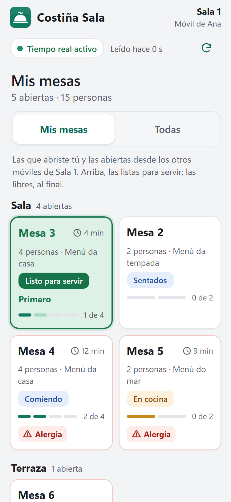

**Las libres, al final** (375 × 812): «Terraza · 1 abierta», con la Mesa 6 y «Alergia · por revisar»; después, «Mesas libres · 2 libres», por sala: la Mesa 1 en «Sala» y la Mesa 8 en «Terraza», cada una con «Libre · 12 plazas» y «＋ Abrir mesa».

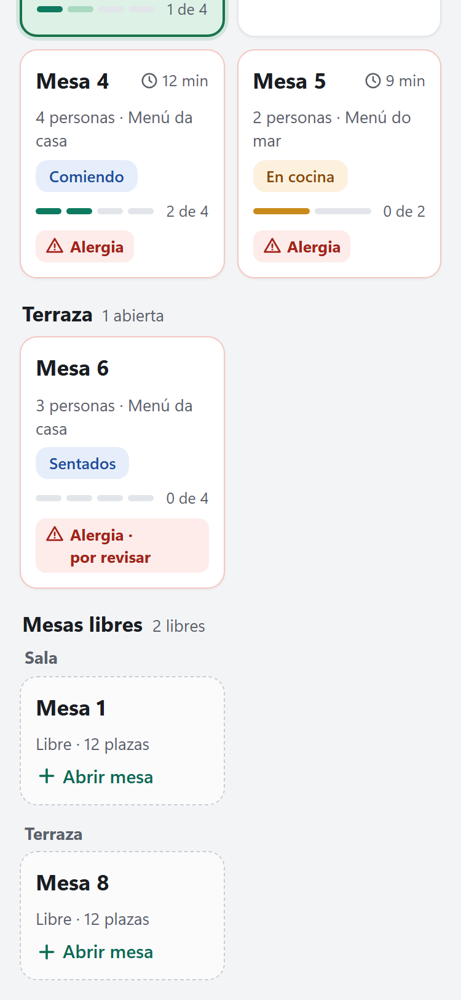

**«Todas»** (375 × 812): «Todas las mesas · 6 de 8 mesas ocupadas · 21 personas» y las pestañas de sala, con «Terraza · 3» elegida: la Mesa 6, la Mesa 7, que abrió el móvil de Uxía en la estación «Terraza» y no está en «Mis mesas» de Ana, y la Mesa 8 libre.

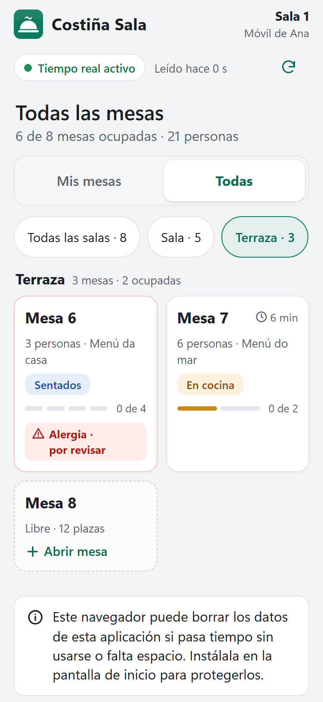

**«Abrir mesa»** (375 × 812): «Abrir Mesa 6 · Terraza · hasta 12 personas», del 1 al 8 con el 3 elegido y «Más…», «Menú da casa» ya elegido con su marca «Menú del día», «Otro menú…» y la primera fila de alergias, con el comensal 2. Abajo, «3 personas · Menú da casa · 1 alergia o intolerancia» y «Abrir Mesa 6».

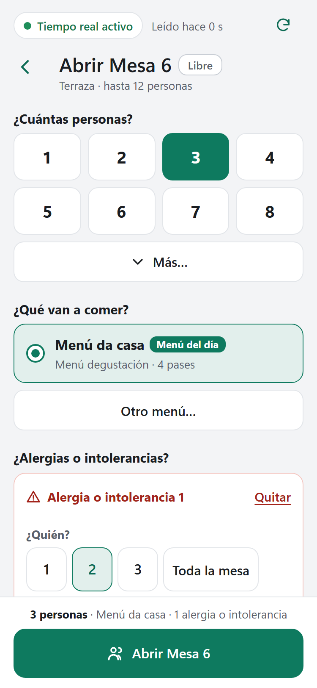

**La fila de la alergia** (375 × 812): la misma hoja, bajada: Comensal 2 · Alergia · «marisco» · Grave (Alergia y Grave son las de por defecto), en rojo porque alarma.

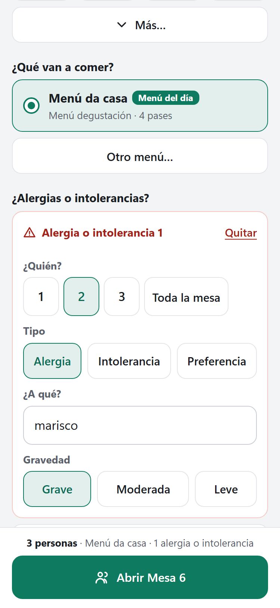

**La ficha** (375 × 812): Mesa 4, «Sala · Menú da casa · 4 personas»; la franja roja con «Cambiar»; «Carta y menús» y «Bodega y bebidas» en una fila; «Pases · 2 de 4 hechos» con «✓ Entrante 15:39 ✓ Primero 15:58»; Principal, con «Siguiente» y «Revisado por cocina»: «Merluza á galega (1 adaptada) × 4 · Cocina caliente · Sin enviar», la línea adaptada del comensal 2 en rojo y el «No le afecta» del comensal 3; abajo, «Último pase servido a las 15:58.» y «Enviar siguiente pase · Principal».

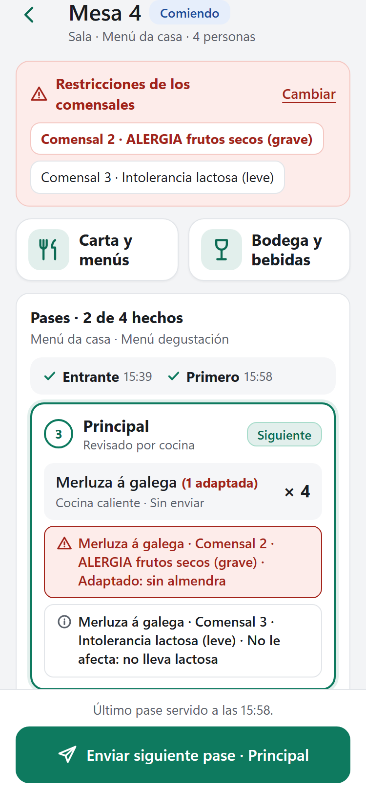

**«Servido»** (375 × 812): la Mesa 5 después de «Ver mesa». Aperitivo en verde, «En el pase desde las 16:10»: «Zamburiñas á prancha (1 adaptada) × 2» con «Adaptado: sin pan rallado», y «Ostras de Arcade × 2» con «No le afecta: no lleva gluten», en rojo porque la alergia es grave; abajo, «Listo en el pase desde las 16:10.» y «Servido · Aperitivo». La cabecera queda cortada para que el pase entero quepa sobre el botón.

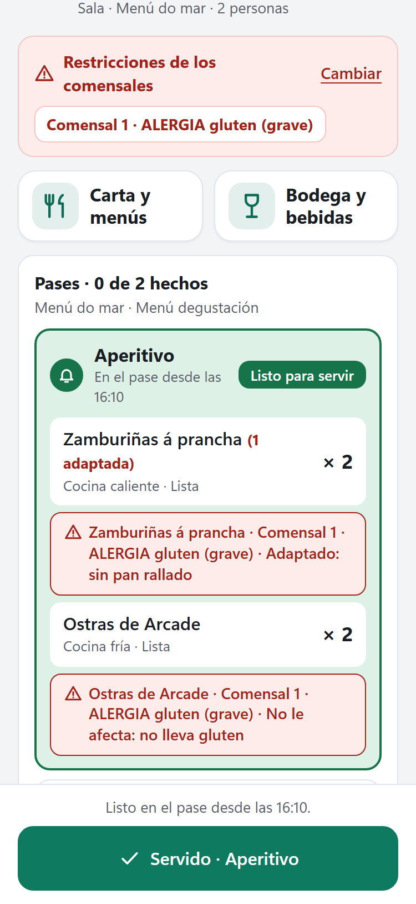

**Después de «Servido»** (375 × 812): «Pases · 1 de 2 hechos», «✓ Aperitivo 16:10», Segundo con «Siguiente» y su línea de la alergia, «Último pase servido a las 16:10.» y «Enviar siguiente pase · Segundo».

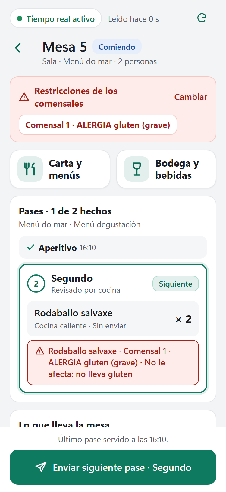

**La banda** (375 × 812): «Mesa 5 · Aperitivo listo para servir», «El pase lo validó a las 16:10», «Servido · Aperitivo», «Ver mesa» y «Visto», sobre «Mis mesas», donde la Mesa 3 y la Mesa 5 están en verde; la 5, con el borde rojo y «Alergia».

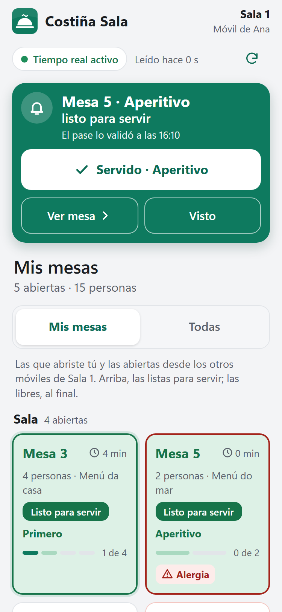

**La banda sobre la ficha de otra mesa** (375 × 812): la misma banda sobre la Mesa 4; la flecha de volver y «Enviar siguiente pase · Principal» siguen a la vista.

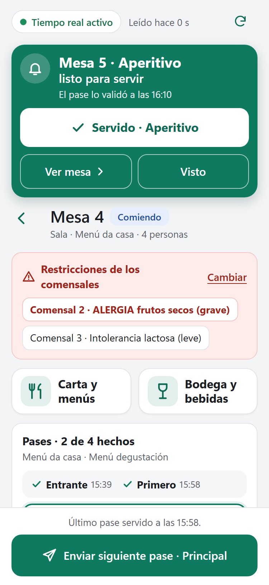

**La hoja de alergias** (375 × 812): «Alergias e intolerancias · Mesa 4 · 4 personas»; «Comensal 2 · ALERGIA frutos secos (grave)» en rojo y «Comensal 3 · Intolerancia lactosa (leve)» en ámbar, cada una con sus platos («Entrante · Empanada de zamburiñas: Servido a las 15:39», «Principal · Merluza á galega: Adaptado: sin almendra», «Postre · Tarta de Santiago: No le afecta: no lleva lactosa»…) y «Retirar».

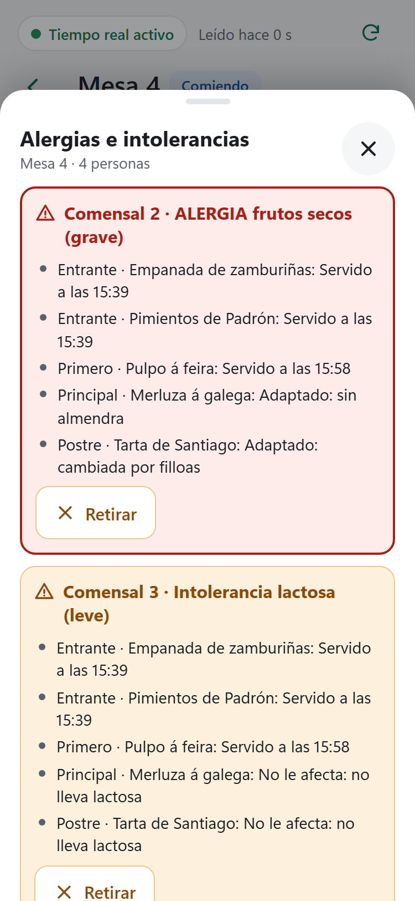

**«Mis mesas» en vertical** (820 × 1180): la «Tableta de sala», en «Sala 1», con las mismas mesas en cuatro columnas; la Mesa 5 ya «Comiendo · 1 de 2» después de servir el aperitivo; «Terraza» y las libres debajo.

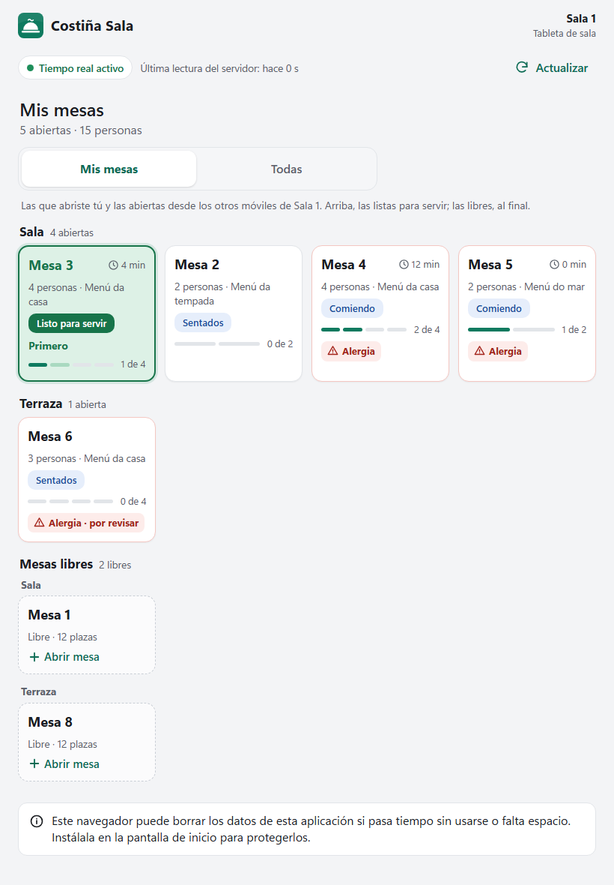

**La ficha en vertical** (820 × 1180): la Mesa 4 en dos columnas. «Carta y menús» con «Menú da casa · 2 de 4 pases hechos»; a la izquierda, «Pases» con Principal y Postre, cada uno con su línea adaptada en rojo; a la derecha, «Lo que lleva la mesa» y «Más opciones»; abajo, «Enviar siguiente pase · Principal». El pie de «Lo que lleva la mesa» es el de C3b, «Los importes solo se ven en Caja.» (ADR-007): es el punto para el promotor de las decisiones.

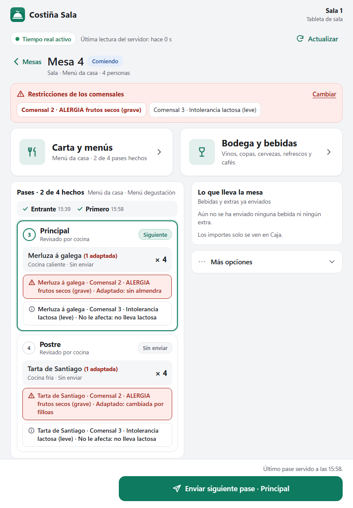

**Cómo se hicieron:**
- dos menús creados por API, como en el PC («Menú da casa» y «Menú do mar»), dan los platos de la maqueta, y el primero pasa a ser el menú del día;
- una segunda estación de sala, «Terraza», con el móvil de Uxía, que abre la Mesa 7; el móvil de Brais, en «Sala 1», abre las mesas 3, 4 y 5, y Ana, emparejada por la pantalla, abre la Mesa 6 desde la hoja;
- las dos salas salen de reescribir `/configuration` en el navegador (las mesas 6 a 8 en una «Terraza»), como `e2e/board.spec.ts`; en la misma reescritura, el menú de ensayo del laboratorio se llama «Menú da tempada». El motor no cambia;
- el laboratorio lo hace todo en un minuto, así que, solo para las capturas, se atrasan las horas de los pases en la instantánea guardada con `psql`, como en C3d;
- la Mesa 3 ya está lista al abrir cada móvil: antes de las capturas de «Mis mesas» se toca «Visto»;
- `checkScreen` antes de cada captura, ninguna clave de dinero y ninguna violación de la CSP. Al terminar, se terminan y liberan solo las mesas que abrió esa ejecución, se desactiva «Terraza» y se revocan los dispositivos que emparejó.

**Para repetirlas** hacen falta una base nueva y el motor compilado con el build actual de la PWA, y `psql` en el `PATH` (lo pone `local-tests.sh`):
1. `npm run build` en `frontend/pwa`.
2. La batería entera, o `dotnet build` de `src/Costina.Server`.
3. `C3E_CAPTURES="$(cygpath -w ~/Costina/docs/native/images/c3e)" COSTINA_E2E=1 sh tools/agent/local-tests.sh http packaging_http pwa_http`.

Usan las mesas M3 a M8 y dejan M1 y M2 para `pwa_http`. En la CI no corren nunca.

## Guion manual corto (solo en una instalación de LABORATORIO; 9 pasos)

Hace falta:
- un PC de laboratorio con una instalación de prueba en `0.46.0-c3e`: la demostración (`/DEMO=1`, D5.6) o el laboratorio de `docs/native/lab-engineering.md`, con la **conexión sencilla** activa (B.2);
- el PC conectado como puesto en la estación de sala de siempre (en el laboratorio, «Sala 1»), con «Comedor y cocina»;
- **un Android y un iPhone o un iPad con Costiña Sala**, por la conexión sencilla (anota modelo, sistema y navegador);
- **una tablet con Costiña Cocina en el Pase** (las estaciones las puede marcar el pase desde «Más opciones») o, si solo tienes los dos móviles, el propio PC: lo de cocina se hace en «Comedor y cocina» tras «Entrar como responsable». En la mesa, «Revisión de cocina», con su nota y «Adaptado» o «No le afecta»; después, «Marcar plato listo» en cada plato y «Validar pase listo · <pase>»;
- en el PC, en Configuración › Salas, mesas y estaciones, **una segunda estación de sala**, por ejemplo «Terraza», solo para el guion;
- un menú cerrado cuyos platos tenga que revisar cocina al anotar una alergia (en el laboratorio, el «Menú de ensayo», que sale ya elegido).

1. **Dos móviles en dos estaciones.** En el PC, «Entrar como responsable» y, en Dispositivos, «Conectar Costiña Sala» con «Sala 1» para el Android y con «Terraza» para el iPhone o el iPad. En cada uno sale «Mis mesas», y la ayuda nombra su estación («…de Sala 1», «…de Terraza»). **Anota** qué mesas ya abiertas salen en los dos: las abiertas antes de E4e, o en el PC con la contraseña del responsable, salen en los dos.
2. **Abrir con una alergia.** En el Android, en «Mesas libres», toca una mesa: el menú del día ya está elegido. Toca «3» en «¿Cuántas personas?», después «Anotar alergia o intolerancia» y, en «¿Quién?», «2»; en «¿A qué?», escribe «frutos secos» (Alergia y Grave ya están elegidas). Después, «Abrir Mesa N». **Anota cuántos toques:** tres (la mesa, las personas y «Abrir») y los de la alergia. Sale la ficha, con «Sentados», «Comensal 2 · ALERGIA frutos secos (grave)» y el botón grande apagado: «Esperando la revisión de cocina». En el iPhone, esa mesa no está en «Mis mesas»; en «Todas», sí, «Sentados».
3. **Cocina revisa y se envía.** En el pase (o en el PC como responsable), decide los platos del comensal 2 (uno «Adaptado: sin almendra»; los demás, «No le afecta»). En el Android, la línea adaptada sale en rojo bajo su plato y el botón dice «Enviar siguiente pase · <pase>»: tócalo.
4. **La banda, solo en el móvil de esa estación.** Toca una vez la pantalla del Android (lo pide la vibración) y deja el iPhone en «Todas». En el pase (o en el PC como responsable), marca lo que falte y valida el pase. En el Android, la banda «Mesa N · <pase> listo para servir», **vibra** (también por http) y la mesa sale arriba, en verde. En el iPhone, la mesa en verde en «Todas», **sin banda**. **Al revés:** abre otra mesa desde el iPhone y llévala hasta «Validar pase». La banda sale en el iPhone, que no vibra nunca, y en el Android **ni banda ni vibración**, aunque se haya tocado la pantalla. Opcional (punto 9 del plan): con el Android bloqueado al validar, la banda sale en cuanto se desbloquea.
5. **«Servido».** En el Android, «Servido · <pase>» en la banda: **un toque**, y la banda se va. En la ficha de esa mesa, «✓ <pase> <hora>», «Último pase servido a las …» y el botón grande «Enviar siguiente pase · …».
6. **La banda no tapa nada** (punto 7 del plan). Con otro pase listo de una mesa del Android, abre la ficha de **otra** mesa y después «Bodega y bebidas» con una ronda sin enviar: la banda sale bajo la cabecera, y la flecha de volver y «Enviar» se ven y se pueden tocar. Abre la ficha de **esa** mesa: sin banda, solo el botón grande «Servido · <pase>».
7. **Una mesa abierta en el PC como puesto.** En el PC, «Salir del modo responsable»: vuelve a ser el puesto de «Sala 1». En «Comedor y cocina», abre una mesa libre y toca «Enviar siguiente pase a cocina». En el Android, esa mesa sale en «Mis mesas» desde que se abre. En el pase (o en el PC, otra vez como responsable), marca lo que falte y valida ese pase: en el Android, la banda y la vibración; en el iPhone, la mesa solo en «Todas», en verde y sin banda. (Abierta con la contraseña del responsable, saldría en los dos: no tiene estación.)
8. **Repaso** (punto 11 del plan). En ninguna pantalla de Costiña Sala aparecen «precio», «cuenta», «pago», «saldo» ni «€», ni códigos de mesa o de estación: solo nombres. **Anota** si el pie de C3b de «Lo que lleva la mesa» se queda («Un punto para el promotor»).
9. **Al terminar.** En el PC, «Entrar como responsable». En «Comedor y cocina», cierra las mesas que abriste desde el iPhone o el iPad: siguen siendo «suyas» por su nombre aunque cambie de estación. En cada una, sirve u omite los pases que queden, «Terminar servicio» y «Liberar mesa». Después, en Dispositivos, «Quitar» el iPhone o el iPad y conéctalo otra vez, con el mismo nombre, en «Sala 1», la estación de todos («Antes de instalar»); y en Configuración › Salas, mesas y estaciones, desactiva «Terraza». En ese móvil, «Mis mesas» enseña ya las mismas mesas que en el Android, y la ayuda dice «…de Sala 1». Al acabar, «Salir del modo responsable».

| Paso | Android (Sala 1) | iPhone o iPad (Terraza) | PC y pase | Notas |
|---|---|---|---|---|
| 1. Dos estaciones | | | | mesas que salen en los dos: |
| 2. Abrir con una alergia | | | | toques: |
| 3. Cocina revisa y se envía | | | | |
| 4. La banda, solo en su estación | | | | ¿vibra por http?: · al revés: · bloqueado: |
| 5. «Servido» | | | | |
| 6. La banda no tapa nada | | | | |
| 7. Mesa abierta en el PC como puesto | | | | |
| 8. Repaso | | | | el pie de C3b: |
| 9. Al terminar | | | | |

## Vuelta atrás

- **El servidor:** C3e no cambia nada de lo guardado, pero desde E4e el instalador no deja bajar de versión. Volver a `0.45.0-c3d` es restaurar la copia previa a la actualización, en un equipo limpio y con el instalador anterior (ver «Antes de instalar»).
- **Los móviles y las tablets:** no guardan nada nuevo. La pestaña elegida y las filas de alergias van en memoria, y `sw.js` y la base del navegador (versión 2) no cambian. Con el servidor anterior, Costiña Sala y Costiña Cocina vuelven a sus pantallas de C3d al recargar, sin emparejar de nuevo. Una orden sin confirmar guardada en un móvil, también una apertura con alergias, es una orden de la API de E4e: se puede reintentar igual.
- **Los dispositivos emparejados de nuevo** para dejar una sola estación de sala se quedan así: lo pide el uso, no la versión.

## Límites y diferido

- **La sala de cada estación** (`core.stations.zone_id`, esquema): «mi sala», ver solo las libres de mi sala y contar como mías las de mi sala abiertas desde otra estación. Irá en un corte de esquema propio, cuando un local con varias salas lo pida.
- **Atribución a la persona**, el camarero con PIN: E5 y el Hito 7, con su ADR.
- **El aviso con la aplicación cerrada o el móvil bloqueado:** el corte del certificado público, con su ADR.
- **Volver a avisar** si un pase listo no se sirve en N minutos, y **el aviso en el PC**: sin corte todavía. Se deciden con lo que salga del guion de C3e.
- **`fire-next` anunciado aunque falte elegir** o con un pase vacío: se arregla en el motor en E4g (`0.49.0-e4g`), que rehace la carta y la comanda de una vez. Hasta entonces, «Falta que algún comensal elija plato…» y «Ese pase no tiene platos pedidos…». Costiña tiene menú cerrado.
- **Elegir y pedir en una sola orden:** E4g. Hasta entonces, una orden por toque.
- **La vista previa «Así lo verá el camarero»:** E4f (`0.47.0-e4f`), con `pases.ts`.
- **Una mesa abierta con una oferta que ya no está vigente:** el móvil solo conoce las ofertas que leyó en esta sesión, así que tras recargar pierde los platos para elegir o pedir de esa mesa. C3e solo lo dice en «Carta y menús» y manda al PC. Recordar esas ofertas en el móvil cambia lo que se guarda en el dispositivo y va con la carta de E4g.
- **Avisar de más:** las mesas sin dato de quién las abrió avisan a todos los móviles. Es lo seguro, y se mide en el guion.
- **Un móvil sin red al actualizar el servidor** sigue con las pantallas de C3d que tiene guardadas, sin «Mis mesas» ni «Todas», hasta que recargue con red. Como la API no cambia, sigue funcionando.
- **Nombres de dispositivo repetidos:** dos móviles con el mismo nombre comparten «Mis mesas». El PC avisa de los nombres repetidos (F12), y ADR-018 deja escrito que esto no es atribución.
- **El puesto del PC en otra estación de sala:** lo que abre no sale en «Mis mesas» de los móviles ni les avisa. Lo cubren «Antes de instalar», el guion y ADR-018.
- **La hoja de alergias no enseña la decisión de un plato ya servido** (decisión 14): las restricciones no tienen hora.
- **`checkScreen` no busca «importe», «caja» ni «euro»** (`MONEY_WORDS`): queda con el pie de «Lo que lleva la mesa» para el promotor.
- **`views.test.ts` exige que cada vista tenga texto que mirar.** `MineList.vue` no escribe nada propio (sus palabras vienen de `mesas.ts`) y pasa por una rareza de la expresión regular, el `>` de `free.length > 0`. Si ese `v-if` cambia, hay que añadirla a la lista `silent` de esa prueba.
- **`foreignAdvice`** no está en la lista de palabras de `tests/labels.test.ts`; la comprueba `tests/commands.test.ts`.
- **Las capturas de cortes anteriores** (`captures.spec.ts`, `captures-c3b.spec.ts`, `captures-c3c.spec.ts`, `captures-e4e.spec.ts`) no se han vuelto a ejecutar: si se repiten, sacarán la Sala de C3e.
- **Problemas de antes, vistos y sin tocar:** `npm run build` no comprueba los tipos de `e2e/`, y la prueba de `pairing.spec` del móvil que sobrevive a una recarga mueve `pwa_http` de una ejecución a otra (entre 146,8 y 176,9 s en este corte).
