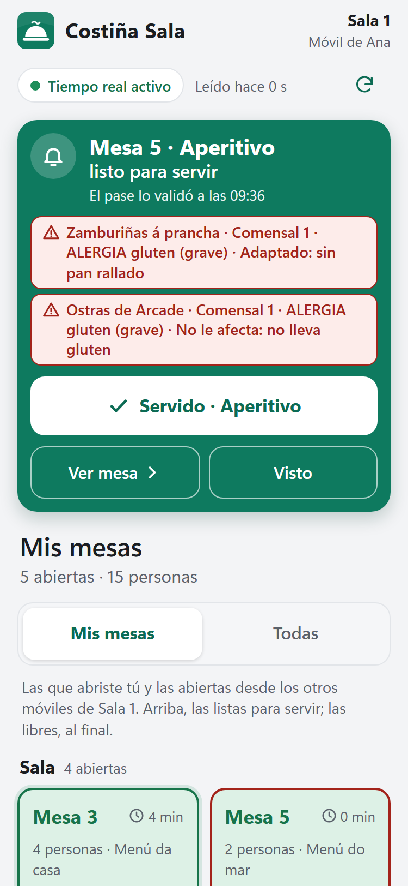
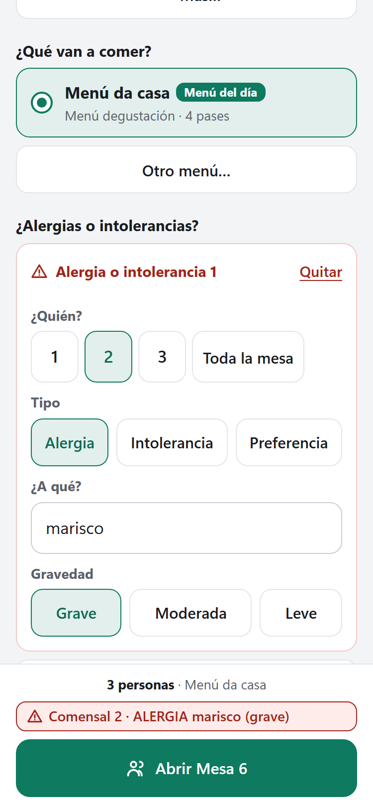
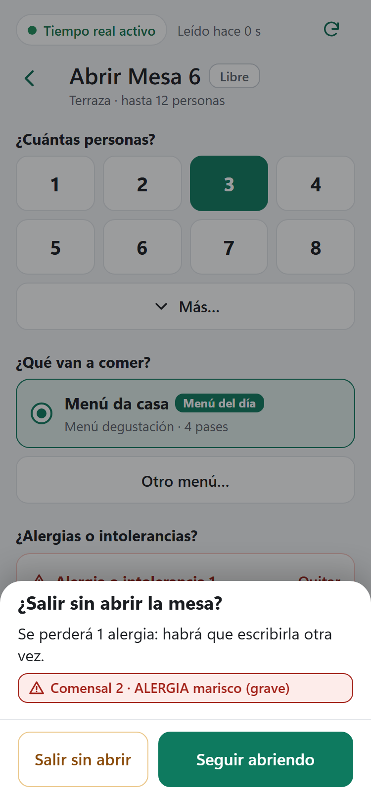
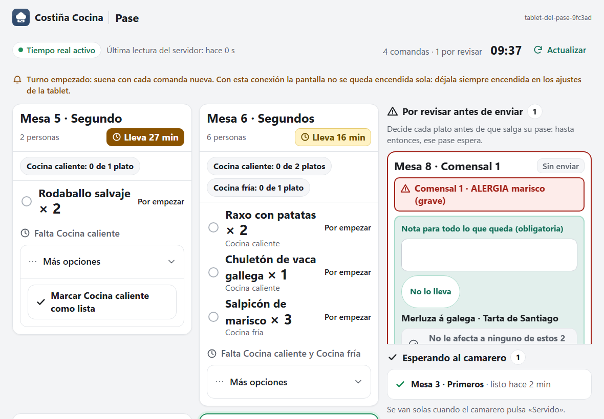
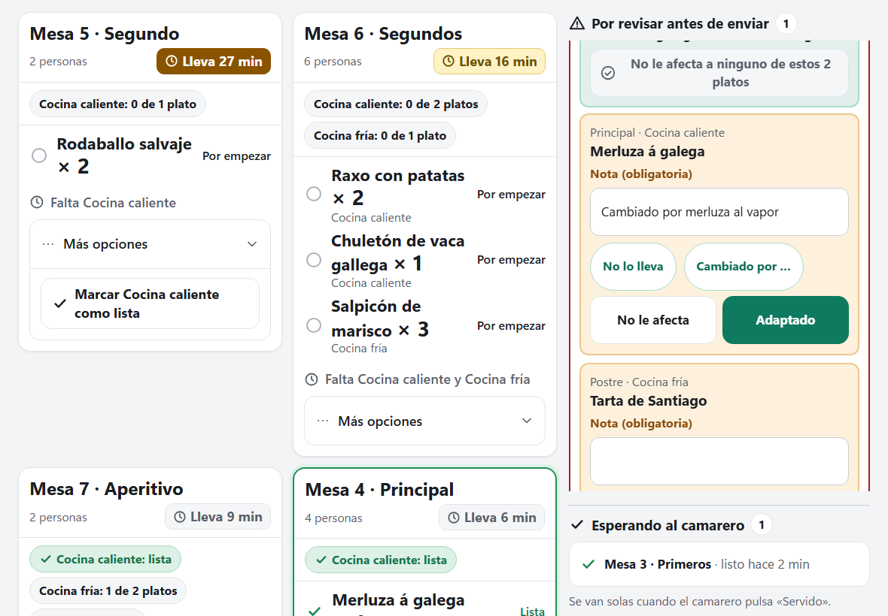
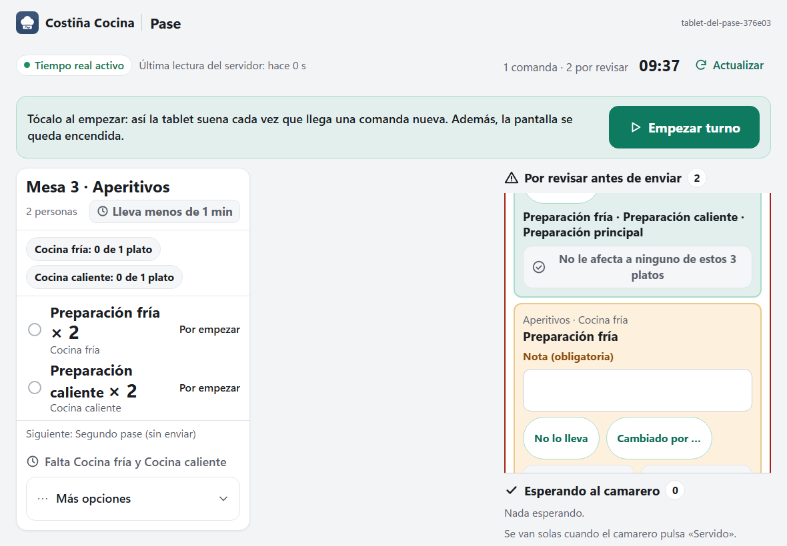
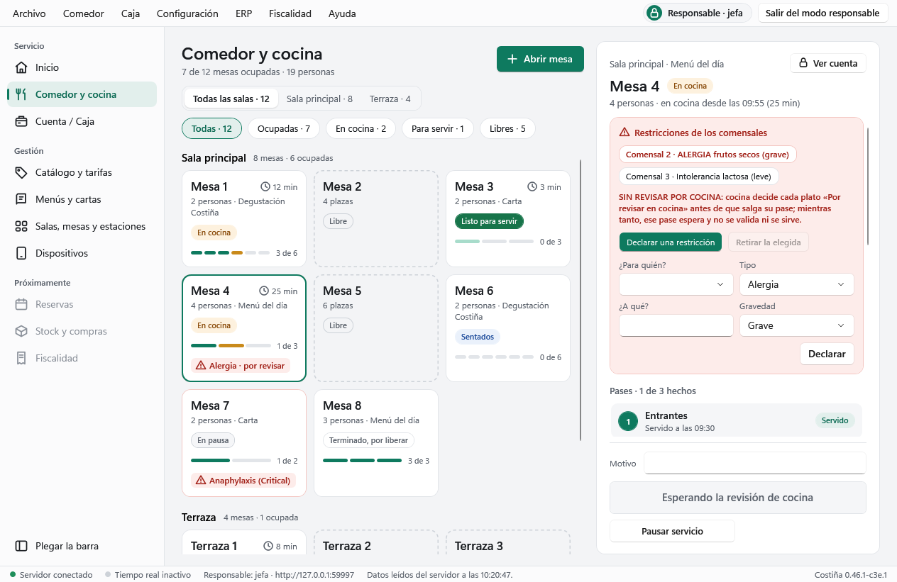

# C3e.1 — Arreglos rápidos de usabilidad en Sala, Cocina y el Comedor del PC

Fecha: 2026-10-29. Rama `fix/c3e1-arreglos-rapidos-usabilidad`, sacada de `develop` `dd7c78c` (Merge PR #99). Corte correctivo tras la evaluación de usabilidad en sala y cocina del 28-10 (`docs/reviews/2026-10-28-usabilidad-sala-y-cocina.md`, con los 76 hallazgos H01 a H76), que puntuó al camarero con 3,5, a la estación con 3,5, al pase con 3 y al PC con 3. Aprobado por el promotor el 29-10 («Haz los arreglos rápidos»): son los seis primeros arreglos rápidos de la lista, con nueve hallazgos (H51, H34, H19, H06, H03, H53, H56, H48 y H20). Versión **`0.46.1-c3e.1`**. **Sin cambio de esquema** (sigue la v8), **de motor, del contrato HTTP, de la CSP ni de la CI**: todo está en las pantallas.

## Lo que notará el promotor

### El camarero (Costiña Sala)

- **La banda «listo para servir» dice ya la alergia.**
  - Bajo el título y antes de «Servido» van las líneas de alergia del pase listo, las mismas que la ficha pinta bajo cada plato. Con 900 px o más, en la tableta horizontal o en un navegador, van de lado a lado bajo la fila del aviso y sus botones. Por ejemplo: «Ostra · Comensal 2 · ALERGIA frutos secos (grave) · Adaptado: sin almendra».
  - Delante van las de toda la mesa («Toda la mesa · ALERGIA gluten (grave)»).
  - Salen en rojo si alarman, en ámbar si están por revisar y en blanco si no. Nada se pliega.
- **El botón grande enseña 1,5 s lo que acaba de hacer, antes de la acción siguiente.**
  - Los textos son «Pase enviado · Aperitivos ✓», «Servido · Principal ✓» y «Mesa abierta · Mesa 5 ✓», en verde y apagados. La banda hace lo mismo con «Servido · Aperitivos ✓», y mientras tanto «Ver mesa» y «Visto» también se apagan.
  - Un doble toque nervioso, o un segundo toque «por si no fue» con la Wi-Fi lenta, ya no manda el pase siguiente a cocina.
  - Si la orden queda sin confirmar y se confirma al reintentar (a mano o sola, al volver la red), también sale, siempre que su botón siga a la vista: la ficha de esa mesa o la banda. Una apertura sin confirmar ya ha vuelto al plano, y allí no sale.
  - Solo se apaga ese botón: la Carta, la ronda y las alergias siguen disponibles.
- **«Abrir mesa» no pierde las alergias escritas.**
  - Encima de «Abrir» va cada alergia entera, como en la ficha: «Comensal 2 · ALERGIA frutos secos (grave)», en rojo si alarma y en ámbar si no. Con más de tres sale una sola línea: «5 alergias o intolerancias anotadas: revísalas arriba antes de abrir.».
  - Con alguna escrita, «Mesas» y «Ver mesa» de la banda preguntan antes de salir. El título es «¿Salir sin abrir la mesa?» y el texto «Se perderá 1 alergia: habrá que escribirla otra vez.», con las filas debajo. Los botones son «Seguir abriendo», la opción segura y con el foco, y «Salir sin abrir».
  - Sin nada escrito, o mientras la apertura de esa misma mesa va camino del servidor, sale sin preguntar. La hoja de otra mesa pregunta siempre.
- **Las hojas de alergias y de omitir pase esperan la respuesta del servidor.**
  - Mientras la esperan, el botón dice «Anotando…», «Retirando…» u «Omitiendo…».
  - Si el servidor la rechaza, la hoja se queda con lo escrito y dice por qué en su sitio. Por ejemplo: «La alergia NO se ha anotado: otro puesto cambió la mesa a la vez y ya se ha vuelto a leer. Toca otra vez.».
  - Si queda sin confirmar, la hoja se cierra y el aviso de arriba se encarga, como con la ronda.
  - Si la relectura que sigue al rechazo quita lo que abría la hoja, el rechazo se sigue leyendo. Pasa, por ejemplo, si la mesa se termina a la vez o si otro puesto ya envió ese pase:
    - la hoja de alergias se queda abierta hasta que el camarero la cierra;
    - el «El pase Postre NO se ha omitido: …» sale en la barra fija de la ficha.

### La estación de cocina

- La línea de un plato por revisar dice qué hacer: «Comensal 1 · ALERGIA marisco (grave) · Por revisar en el pase · no lo emplates hasta que decida». Sigue en rojo si alarma y nunca se pliega.
- Solo sale en lo que aún no está marcado «Listo». Bajo un plato ya «Lista» de la rejilla, y en «Hecho · esperando al pase», sigue «Por revisar en el pase»: ahí, «no lo emplates» haría creer que hay que retirarlo.
- «Listo» no cambia. Si se puede marcar con una revisión pendiente sigue siendo la decisión 5 de la sección 5c del informe.

### El pase

- **«Rehacer» va aparte y en dos pasos.**
  - Va en su propia fila, con borde ámbar oscuro (nunca rojo).
  - El primer toque no manda nada. En su sitio sale «¿Rehacer Merluza á galega? Vuelve a la estación.», con «Cancelar» y «Sí, rehacer».
  - La pregunta ocupa el mismo sitio y alto que el botón, así que el segundo toque de un doble toque cae en el texto. «Cancelar» no borra la nota.
- **«No le afecta» y «Adaptado» ocupan todo el ancho y ya no se parten en dos líneas.**
- **«No le afecta a nada más» sube a la cabecera del comensal**, justo bajo su alergia y antes de sus platos.
  - Encima del botón van enteros los platos que decide: «Ostra · Merluza á galega × 2 · Tarta de queso».
  - El botón los cuenta: «No le afecta a ninguno de estos 3 platos», o «No le afecta a este plato».
  - La nota sigue siendo obligatoria.
- **«Sin gluten» solo se ofrece si alguna restricción que aplica es de gluten** («gluten», «celíaco», «celiaquía»), ya sea del plato, de toda la mesa o, en «nada más», del comensal. Los atajos se separan 10 px; antes, 6.

### El encargado en el PC (Comedor)

- «Declarar una restricción» en una mesa abierta es la misma fila que cada alergia del alta:
  - «¿Para quién?» empieza sin elegir. Ofrece «Comensal 1» a «Comensal n» y, al final, «Toda la mesa», que es una opción más y nunca la de por defecto.
  - Luego van «Tipo» (Alergia), «¿A qué?» y «Gravedad» (Grave). «Declarar» va debajo.
- Sin elegir para quién no sale ninguna orden, y la barra de estado dice lo mismo que el alta: «Elige para quién es cada alergia o intolerancia: un comensal o toda la mesa.».
- La fila vuelve a empezar entera al confirmarse, al quedar sin confirmar (la orden pendiente ya la lleva, y «Reintentar» manda la misma), al cambiar de mesa y cuando falla la lectura. Solo un rechazo la conserva, para corregirla.

## Los defectos y su causa

1. **H51, PC (alta).** Tras «Declarar» solo se vaciaba la sustancia. Comensal, tipo y gravedad se quedaban, también al cambiar de mesa, y un comensal vacío contaba como toda la mesa. Una alergia grave al gluten anotada después de «Comensal 3 · Preferencia · Leve» salía como preferencia leve del comensal 3, en ámbar y para la persona equivocada. El alta de mesa y el móvil ya lo hacían bien.
2. **H34, estación (alta; aquí solo la parte de texto).** La estación leía «Por revisar en el pase» con el «Listo» activo debajo, y nada le decía si debía esperar. El sonido y la marca de los cambios de alergia siguen en el corte «Estación con volumen y cambios».
3. **H19, banda «listo» (media).** La banda decía la mesa y el pase, pero no la alergia ni a qué comensal iba el plato adaptado. Había que abrir la ficha para saberlo.
4. **H06, «Abrir mesa» (media).** Con alergias escritas, «Mesas» o «Ver mesa» de la banda cerraban la hoja sin preguntar y las alergias se perdían. Encima de «Abrir» solo decía «1 alergia o intolerancia».
5. **H03, hojas de alergias y de omitir (media).** La hoja emitía la orden y se cerraba a la vez. Si el servidor la rechazaba, lo escrito se perdía y el motivo salía arriba, lejos.
6. **H53, «Rehacer» en el pase (media).** «No le afecta», «Adaptado» y «Rehacer» eran tres botones de 80 px, juntos, y «No le afecta» se partía en dos líneas. Tocar «Adaptado» queriendo «Rehacer» deja salir como adaptado un plato ya cocinado.
7. **H56, «No le afecta a nada más» (media).** Iba después de todos los platos del comensal: con un menú de 7 pases había que pasar 7 formularios.
8. **H48, atajos del pase (media).** Se ofrecía «Sin gluten» ante «ALERGIA marisco (grave)», y nada impedía guardar «Adaptado: Sin gluten», que es lo que leen la estación y Sala. Los atajos estaban a 6 px.
9. **H20, botón grande (media).** «Abrir Mesa N» y, justo después, «Enviar siguiente pase» ocupaban el mismo botón. Lo mismo pasaba con «Servido» y el envío del pase siguiente. Un segundo toque mandaba a cocina el pase siguiente.

## Qué cambia

### Costiña Sala (PWA)

- **`operations.ts`**
  - `DONE_MS = 1500` y el estado `done` (`{ text, place }`).
  - `run(path, body, description, result?)`: con la orden confirmada, `done` sale al momento y dura `DONE_MS` desde que termina la relectura.
  - Una orden que queda sin confirmar guarda su resultado con la clave de ESA pendiente (`pendingDone`). `retry` y el reintento automático lo vuelven a pedir: los dos salen por `retryPending`, que toma la clave reintentada antes de reintentar. Si el intento adopta la orden de otra pestaña, no hereda el resultado.
  - `locked` no mira `done`: apaga el sitio quien lo pinta.
- **`ficha.ts`, `sala.ts` y `pases.ts`**
  - `doneLabel` (el resultado se calcula al tocar, con la lectura de la que salió el botón) y `openedLabel` («Mesa abierta · <mesa> ✓»).
  - `servedLabel`.
  - `passLines`: las líneas de alergia de un pase, montadas sobre las piezas comunes `dishes`, `exceptionLine`, `wholeTable` y `restrictionLabel`. La ficha (`CoursesTimeline`) usa ahora las mismas piezas (`exceptionText`, `lineTone`), así que el texto y el color de la banda y de la ficha no se pueden separar.
- **`ReadyBanner.vue` y `BoardView.vue`**
  - La banda pinta `banner-lines` y `banner-done`. Mientras dura el resultado, sigue enseñando el aviso servido.
  - `BoardView` decide qué botón pinta el resultado: `cardDone`, `openDone` o `bannerDone`.
  - `openSending` guarda la mesa cuya apertura está en camino (hasta que termina su relectura), y `openSheet` la hoja que la mandó. Solo esa hoja deja de preguntar al salir (`submitted` en `OpenTable`) y pinta «Mesa abierta ✓». Si el camarero salió de ella y volvió a tocar la misma mesa, la hoja nueva pregunta al salir y, al confirmarse la primera apertura, se queda con sus filas.
  - `sendSettled` es la antigua `sendRound` con un nombre general, porque ahora la usan también las hojas.
- **`abrir.ts` y `OpenTable.vue`**
  - `draftLabel`, `draftLines`, `openLines`, `lostText` y los textos `LEAVE_*`. `openSummary` ya no recibe las filas.
  - `leave()` pregunta solo con filas escritas y sin la apertura de esa mesa en camino. La expone `defineExpose` para «Ver mesa».
- **`commands.ts`, `AllergySheet.vue` y `SkipSheet.vue`**
  - `notApplied` decide si la hoja se cierra y qué dice.
  - Los motivos cortos de `DECLINED`. «Toca otra vez» sale solo con `version_conflict` o `not_sent`.
  - `REJECTIONS` gana `service_finished` y `restriction_not_found`, con los textos del PC.
  - Si la relectura quita el alta o la tarjeta, el rechazo sigue a la vista en la hoja.
  - `TableCard`: `sheetSending` cuenta las órdenes de las hojas en camino, y la hoja de alergias no se cierra mientras haya alguna. `skip` pone en `action-problem`, la barra fija, el rechazo de omitir cuya hoja ya no existe.
- **`data-testid` nuevos**
  - `do-done`, que sustituye al botón grande mientras dura: sigue habiendo un solo «do-» por pantalla.
  - En la banda, `banner-done`, `banner-lines` y `banner-line`.
  - En «Abrir mesa», `open-lines`, `open-line`, `open-leave-sheet`, `open-leave-text`, `open-leave-stay` y `open-leave-discard`.
  - En la hoja de alergias, `declare-rejected`.

### Costiña Cocina (PWA)

- **`cocina.ts`**
  - `REVIEW_PENDING_AT_STATION` y `stationLine`, solo para la rejilla de la estación y solo bajo un plato que aún no está «Lista».
  - `noteShortcuts` con `isGluten`: la sustancia en minúsculas y sin tildes contiene «gluten», «celiac», «coeliac» o «celiaqu».
  - `restDishes` y `restButton`.
- **`KitchenView.vue`**
  - «Rehacer» en dos pasos, con los `data-testid` `remake-…` (primer paso), `remake-step-…` y `remake-cancel-…`.
  - `do-review-remake-…` es ahora solo «Sí, rehacer», la que manda la orden.
  - La pregunta se cierra si su revisión ya no está en el pase, porque otro puesto la decidió.
  - El bloque `presend-rest` va arriba, con `presend-rest-dishes-…` y su propio `conflict-rest-…` junto al botón.
  - `showsRest` es la condición del bloque. Si la relectura lo quita, su `version_conflict` sale al final de la tarjeta.
  - En la rejilla, bajo un plato ya «Lista», va `exceptionLine` en lugar de `stationLine`.
- **`style.css`**
  - Decisiones a todo el ancho, sin partirse.
  - «Rehacer» con `--warn-text`.
  - Atajos a 10 px.
  - `.rest-dishes` a 18 px en negrita.

### Puesto principal (WPF)

- **`ServiceViewModel`**
  - `DeclareDraft` es un `AllergyDraft`, la misma clase que las filas del alta, y `DeclareGuestChoices` sale de la pax de la mesa leída.
  - `CheckDraft` y `GuestPosition` son comunes con el alta.
  - `ResetDeclare` rehace la fila al confirmar, al quedar sin confirmar (solo si la pendiente es esta declaración, comparando ruta y cuerpo, como la ronda en `DrinksViewModel`), en `Invalidate` y al cambiar de mesa en `Render`.
  - Una relectura de la misma mesa no toca lo que se está escribiendo.
- **`ServiceView.xaml`**: «¿Para quién?», «Tipo», «¿A qué?» y «Gravedad» en dos filas, y «Declarar» debajo. Desaparecen la caja «Comensal» (vacía = toda la mesa) y «Sustancia o preferencia».

## La revisión del corte

Tres revisores leyeron el diff: seguridad y corrección, usabilidad y coherencia, y pruebas. Encontraron 23 hallazgos en bruto, que quedaron en 15 al unir los repetidos. Un verificador escéptico confirmó 12, y se aplicaron todos:

- encima de «No le afecta a …», los platos que decide, y el botón los cuenta;
- su `version_conflict`, junto al botón;
- en el PC, una declaración sin confirmar también vacía la fila;
- el resultado también tras reintentar;
- la pregunta de «Rehacer» se cierra si otro puesto decide;
- salir de «Abrir mesa» con la apertura en camino no pregunta;
- los rechazos que quitan el alta o la tarjeta se siguen viendo;
- el resultado ya no bloquea el resto de la pantalla;
- «Hecho» sin «no lo emplates»;
- dos pruebas más del resultado;
- «Mesa abierta · <mesa> ✓» y «El pase <pase> NO se ha omitido», que concuerdan con cualquier nombre;
- en `abrir.ts`, el PC se cita por nombre y no por número de línea.

Descartó tres, que no son defectos del corte y quedan en lo diferido: que el bloque de arriba baje los botones del primer plato (es H50), que la banda servida se vaya y el contenido salte (es H23) y el «Rehacer» del PC.

**Revisión final.** Después, otras tres lentes leyeron lo del corrector y este documento:

- la corrección del código que nadie había revisado;
- la exactitud del documento frente al código;
- la seguridad alimentaria, la coherencia y los huecos de prueba.

Encontraron 27 hallazgos y un verificador confirmó 16. Se aplicaron todos. Son estos:

- **Código** (uno medio y cinco bajos):
  - con la apertura de una mesa en camino, la hoja de OTRA mesa salía sin preguntar y perdía sus alergias;
  - el rechazo de omitir desaparecía con la hoja;
  - la hoja de alergias se cerraba antes de decir el rechazo si la relectura quitaba el alta;
  - un reintento que adoptaba la orden de otra pestaña heredaba el resultado;
  - el `version_conflict` de «No le afecta a …» se iba con su bloque;
  - un plato ya «Lista» decía «no lo emplates».
- **Documento**, ocho:
  - el guion prometía «Enviar siguiente pase» tras abrir con una alergia, cuando sale «Esperando la revisión de cocina»;
  - AGENTS decía «never a count» y con más de tres alergias hay recuento;
  - «la apertura ya enviada» en vez de «en camino»;
  - el resultado tras reintentar no sale en el plano;
  - la banda en 900 px o más;
  - la nota de C3e con más de tres;
  - qué textos son nuevos;
  - la línea de la estación bajo un plato ya «Lista».
- **Pruebas**: «Salir sin abrir» no tenía ninguna. Ahora la recorre `mesas.spec`, y `views.test` comprueba el cuerpo de `discardAndLeave`.

Un último revisor de esos arreglos encontró uno más, que ya existía antes de este corte, y también se arregló:

1. con la apertura de M5 en camino, el camarero sale y vuelve a tocar M5;
2. escribe otra alergia en la hoja nueva;
3. al confirmarse la primera apertura, esa hoja se cerraba y llevaba a la ficha sin preguntar.

Descartó 11 hallazgos. Entre ellos está el riesgo de «No le afecta a ninguno de estos N platos», que es lo aprobado y queda en «Para revisar con el promotor», y el de una alergia duplicada en el PC, que es de H27.

## Capturas

Están en `docs/native/images/c3e.1/` y salen de los mismos specs de captura que C3e, C3d y E4e (`captures-c3e.spec.ts`, `captures-c3d.spec.ts` y `captures-e4e.spec.ts`), contra el motor real y con la escena de siempre. Solo se guardan las que enseñan algo nuevo, más la del PC, que sale de DesktopChecks.

**La banda «listo para servir»** (375 × 812): «Mesa 5 · Aperitivo listo para servir». Debajo van, en rojo, «Zamburiñas á prancha · Comensal 1 · ALERGIA gluten (grave) · Adaptado: sin pan rallado» y «Ostras de Arcade · Comensal 1 · ALERGIA gluten (grave) · No le afecta: no lleva gluten». Después vienen «Servido · Aperitivo», «Ver mesa» y «Visto» (H19).

**«Abrir mesa» con una alergia escrita** (375 × 812). Encima de «Abrir Mesa 6» va «3 personas · Menú da casa» y, debajo, la alergia entera en rojo: «Comensal 2 · ALERGIA marisco (grave)» (H06).

**Salir con la alergia escrita** (375 × 812): la hoja «¿Salir sin abrir la mesa?» dice «Se perderá 1 alergia: habrá que escribirla otra vez.». Debajo va la fila en rojo, con «Salir sin abrir» y «Seguir abriendo» (H06).

**El pase** (1180 × 820). En «Por revisar antes de enviar», «Mesa 8 · Comensal 1», con «Comensal 1 · ALERGIA marisco (grave)». Justo debajo, y antes de los platos, va «Nota para todo lo que queda (obligatoria)» con un solo atajo, «No lo lleva»: sin «Sin gluten», porque es marisco (H48). Después, los platos que decide, «Merluza á galega · Tarta de Santiago», y «No le afecta a ninguno de estos 2 platos» (H56).

**El pase, desplazado hasta los platos** (1180 × 820): «Merluza á galega» con la nota «Cambiado por merluza al vapor», los atajos «No lo lleva» y «Cambiado por …» a 10 px, y «No le afecta» y «Adaptado» a partes iguales y sin partirse (H53, H48).

**«Por revisar antes de enviar» con tres platos** (1180 × 820): «Preparación fría · Preparación caliente · Preparación principal» y «No le afecta a ninguno de estos 3 platos», en la cabecera del comensal (H56).

El resultado del botón grande (H20) dura 1,5 s y no sale en estas capturas. Lo comprueban `mesas.spec`, `banner.spec` y `operations.test.ts`. «Rehacer» en dos pasos (H53) lo recorre `kitchen.spec`.

**El PC, Comedor** (de DesktopChecks, con su servidor simulado). La Mesa 4 lleva abierta «Declarar una restricción». «¿Para quién?» está vacío; «Tipo» dice «Alergia», «¿A qué?» está vacío y «Gravedad» dice «Grave». Debajo, «Declarar». En la barra de estado, «Costiña 0.46.1-c3e.1» (H51).

## Qué NO cambia

- El motor, la API, el esquema, la CSP y la CI.
- El vocabulario común: `Costina.Client/Labels.cs` y las tablas de casos de `dotnet/tests/fixtures/`. Los textos nuevos son solo de la PWA, como `BUTTON` en `ficha.ts`: botones, hojas, la línea de la estación y los platos encima de «No le afecta a …». Los dos nuevos de `REJECTIONS` copian los del PC.
- Los permisos: cada botón sigue existiendo solo si el servidor anuncia su acción.
- La regla del rojo: solo para alergias, o para cualquier restricción grave. Una preferencia leve que no se anota sale en ámbar.
- La cocina no pide nunca resultado: `done` es solo del botón grande y de la banda de Sala.
- La ronda, la Carta, «Más opciones» y la orden sin confirmar se comportan como en `0.46.0-c3e`.

## Comprobaciones automáticas

Todo en este PC el 29-10, con la versión `0.46.1-c3e.1`. La batería completa se corrió dos veces, antes y después de la revisión final; las cifras son las de la punta final (`da742fc`):

- **vitest: 600 pruebas en 23 ficheros** (562 en C3e, 38 más). `npm run typecheck` y `npm run build`, en verde.
  - En `operations.test.ts`:
    - el resultado sale antes de releer y dura `DONE_MS`;
    - no sale con un rechazo ni con una orden sin confirmar;
    - sale si la orden se confirma al reintentar, a mano o sola;
    - no sale si el reintento adopta la orden de otra pestaña;
    - no bloquea el resto (`locked` en falso).
  - En `ficha.test.ts`, `sala.test.ts` y `pases.test.ts`: los textos del resultado (también con «Reservado 2») y `passLines`.
  - En `abrir.test.ts` y `commands.test.ts`: las líneas de encima de «Abrir», `lostText`, `notApplied` (también con un pase en plural) y los textos nuevos de `REJECTIONS`.
  - En `cocina.test.ts`: `stationLine`, el filtro de gluten, `restDishes` y `restButton`.
  - En `views.test.ts`:
    - la plantilla de «Rehacer»;
    - la pregunta que se cierra sola;
    - el bloque «nada más» arriba con su `version_conflict`;
    - «Hecho» sin «no lo emplates»;
    - `:sending`, el rechazo fuera del alta y el estilo compacto de la banda.
  - Tres de las pruebas nuevas de `operations.test.ts` se vieron fallar a propósito: las dos del reintento, con `retryResult` quitado, y la de la otra pestaña, sin comparar la clave reintentada.
- **ClientChecks: 288** (no cambian) y **dominio: 97/97**.
- **Las 14 suites HTTP**, en verde: packaging 15 (1 saltada), native 11, security 6/6, desktop_reads 9, affordances 8, restrictions 9, checkout 8, identity 10, pairing 18, station 11, organization 5, catalog 10, offers 8 y pwa_http 8 (185 s; 208 s en la primera). **Realtime: 13**.
- **Playwright: 31 de 31 contra el motor real, en 3,0 min** (3,4 en la primera): 14 de escritorio, 15 de móvil, 1 de `tableta` y 1 de `sala-vertical`.
  - **`mesas.spec`** (12,2 s en `[mobile]` y 12,4 s en `[sala-vertical]`; 6,7 y 6,8 s en C3e) comprueba:
    - el resumen de «Abrir» sin el recuento y con la alergia entera en rojo;
    - «Mesas» con la alergia escrita: la pregunta, y «Salir sin abrir», que vuelve al plano con la mesa libre y sin mandar nada;
    - al volver a la mesa, la hoja empieza sin filas; con la alergia escrita otra vez, «Seguir abriendo» conserva la fila sin mandar nada;
    - «Mesa abierta · Mesa 5 ✓» en la hoja y en la ficha;
    - «Pase enviado · Aperitivos ✓»;
    - en la banda, la línea adaptada en rojo y su alto, menor que el 60 % de la pantalla;
    - «Servido · Aperitivos ✓» y un segundo toque que no envía nada;
    - un rechazo simulado de `declare-restriction` (409 `version_conflict`): la hoja sigue abierta, con «sésamo» escrito y el aviso en rojo.
  - **`banner.spec`** (6,2 y 6,3 s) comprueba la línea «ALERGIA sésamo (grave)» con «No le afecta: no lleva sésamo» en la banda y «Servido · <pase> ✓» antes de que se vaya.
  - **`kitchen.spec`** (10,2 s) comprueba:
    - el bloque «nada más» arriba, con sus platos y su botón;
    - sin «Sin gluten» ante la lactosa;
    - atajos a 8 px o más;
    - «No le afecta» en una línea;
    - el texto nuevo de la estación, y «Hecho» sin él;
    - «Rehacer» en dos pasos: «Cancelar» no manda nada y «Sí, rehacer» manda una `review-preparation` con `remake`.
  - **`commands.spec`** espera ahora a la acción siguiente después del resultado.
- **La batería completa con `COSTINA_E2E=1`: `exit 0`** las dos veces, cada una a la primera. Los registros están en `.lab-test/c3e1-battery.log` y `c3e1-battery-2.log`, y los de Playwright en `c3e1-pwa_http.log` y `c3e1-pwa_http-2.log`.
- **DesktopChecks: en verde** («WPF startup and viewmodel checks passed»).
  - Las comprobaciones nuevas de H51 son:
    - los valores de partida en el viewmodel y en los controles;
    - los textos del alta pintados y los viejos ausentes;
    - sin comensal no hay POST;
    - un rechazo `invalid_guest` lo conserva todo;
    - la orden confirmada lleva lo elegido y vacía la fila;
    - «Toda la mesa» viaja como `guestPosition` null;
    - al cambiar de mesa, la fila vuelve a empezar con los comensales de esa mesa;
    - una relectura de la misma mesa conserva lo escrito y una lectura fallida lo vacía;
    - una declaración sin confirmar vacía la fila, y «Reintentar» manda la misma clave y el mismo cuerpo.
  - En la punta final, en verde a la primera. Antes de la revisión final lo estuvo a la tercera: las dos primeras ejecuciones, con el PC en uso por otras ventanas, fallaron cada una en un sitio distinto y que C3e.1 no toca: la ficha de impuestos del Catálogo y las dos columnas de mesas de Organización a 1280 px. Los agentes del corte la habían pasado tres veces en verde.
  - Ojo: `local-tests.sh desktop` termina con `| tail -2` y siempre devuelve 0. Hay que leer la última línea, no el código de salida.

## Para revisar con el promotor

*Contestadas el 29-10 («1b, 2a, 3a, 4a, 5a»):*

1. **b:** «No le afecta a ninguno de estos N platos» lleva un segundo paso, como «Rehacer». Se hace en C3e.2 (`0.46.2-c3e.2`, `C3e.2-segundo-paso-no-le-afecta.md`).
2. **a:** se queda «Mesa abierta · Mesa 5 ✓».
3. **a:** la banda no se recorta. Su tamaño va al corte «Sala: avisos que se ven» (H18, H23).
4. **a:** el atajo «Sin gluten» sigue solo para «gluten», «celíaco» y «celiaquía».
5. **a:** la estación sigue pudiendo marcar «Listo» con una revisión pendiente. La opción c, que «Adaptado» devuelva a la estación un plato ya hecho, no se ha decidido.

Las preguntas, tal como se hicieron:

1. **«No le afecta a ninguno de estos N platos», ahora arriba.** Con un toque decide todos los platos que quedan del comensal, también el que lleva el alérgeno si aún no se ha adaptado. Los platos van escritos encima y la nota es obligatoria. ¿Se le pone un segundo paso, como a «Rehacer»?
2. **«Mesa abierta · Mesa 5 ✓» en lugar de «Mesa 5 abierta ✓».** Es para que concuerde con cualquier nombre de mesa («Reservado 2»).
3. **Con varias alergias largas en un pase, la banda del móvil puede pasar de 400 px** y empujar el contenido. No se esconde ninguna línea. Va con la píldora fija y la banda que no mueve nada (H18, H23).
4. **Qué cuenta como gluten para el atajo.** Cuentan «gluten», «celíaco» y «celiaquía». Trigo, cebada, centeno, avena y espelta no: un producto sin gluten puede llevar almidón de trigo desglutinado, y «Adaptado: Sin gluten» no diría lo que se quitó.
5. **La estación sigue pudiendo marcar «Listo» con una revisión pendiente.** Es la decisión 5 de la sección 5c del informe.

## Guion para el promotor (laboratorio)

1. **En el móvil, «Abrir mesa»:**
   - escribe una alergia y toca «Mesas»: sale la pregunta, y «Seguir abriendo» conserva la fila;
   - abre: el botón dice «Mesa abierta · Mesa N ✓» y, 1,5 s después, «Esperando la revisión de cocina», apagado, porque la mesa lleva una alergia (sin alergias diría «Enviar siguiente pase · …»).
2. **Envía un pase con un plato adaptado y márcalo listo en cocina:** la banda dice la alergia y la adaptación. Toca «Servido» dos veces seguidas: la segunda cae en «Servido · … ✓» y no envía nada.
3. **En la tablet de la estación:** un plato por revisar dice «no lo emplates hasta que decida».
4. **En el pase:**
   - «Rehacer» pregunta antes;
   - «No le afecta a ninguno de estos N platos» está arriba, con los platos escritos;
   - con una alergia al marisco no se ofrece «Sin gluten».
5. **En el PC, Comedor, una mesa ocupada, «Declarar una restricción»:**
   - empieza sin comensal, con Alergia y Grave;
   - anota «Comensal 3 · Preferencia · Leve · sin cebolla», cambia de mesa y vuelve a abrir la fila: empieza de cero.

## Límites y diferido

- **De la lista de arreglos rápidos quedan los puntos 7 a 10 y H21**, la orden sin confirmar a la vista, que es la otra mitad del punto 6. Necesitan otro permiso.
- **El PC sigue con «Rehacer» de un clic.** H53 se midió en la tablet del pase. Queda para el corte del PC (coherencia PC y pase).
- **`duplicate_restriction` no tiene texto en `Labels.cs`** (es de la familia de H27). Tocarlo obliga a cambiar `vocabulary-cases.json`.
- **Un rechazo que llega en el reintento automático no lo dice la hoja.** Si una anotación queda sin confirmar y el reintento la rechaza (otro puesto cambió la mesa entretanto), la hoja ya está cerrada y solo el aviso de arriba dice el motivo.
- **Queda abierto un caso muy improbable del resultado (H20).** Una orden NUEVA del botón grande podría encontrar el hueco ocupado por la orden de otra pestaña, del mismo móvil y la misma persona, que llega justo entre la reserva y el intento. Entonces adoptaría esa orden y guardaría su resultado con ella. Cerrarlo pide que el `Outcome` diga qué clave se intentó.
- **Con un comensal de varios platos arriba, el bloque «nada más» baja unos 200 px los formularios de cada plato.** Se resuelve con H50 en el corte «Pase con carga» (plegar cada plato y quitar el desplazamiento interior).
- **La banda servida se va tras `DONE_MS` y el contenido sube.** Ya pasaba antes, y justo bajo el dedo. Que H23 cuente también la salida de la banda.
- **Las capturas de C1, E2, E4a, C3d y C3e enseñan lo de antes.** Son históricas de su corte. Las de este, en `images/c3e.1/`.
- **Nada se ha probado en aparatos reales** (H70).

## Vuelta atrás

C3e.1 no cambia los datos ni hay que emparejar de nuevo ningún aparato. Pero, desde E4e, el instalador no deja bajar de versión: volver a `0.46.0-c3e` es restaurar la copia previa a la actualización, en un equipo limpio y con el instalador anterior.
