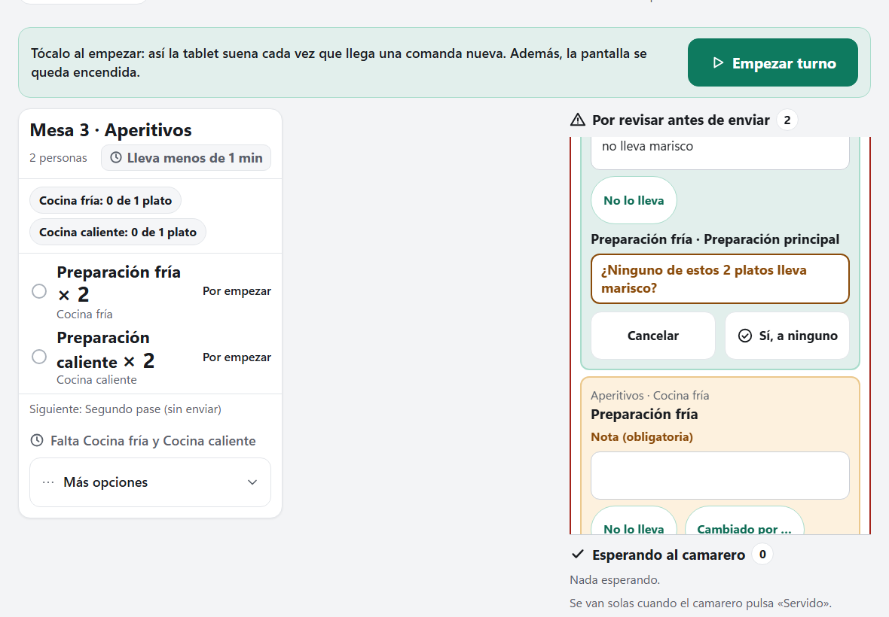

# C3e.2 — «No le afecta a ninguno de estos N platos» en dos pasos

Fecha: 2026-10-29. Rama `fix/c3e2-segundo-paso-no-le-afecta`, sacada de `develop` `4e460a2` (C3e.1 mezclada, `0.46.1-c3e.1`). Es la decisión 1 de las cinco que C3e.1 dejó para revisar: el promotor contestó el 29-10 «1b, 2a, 3a, 4a, 5a» (ver `C3e.1-arreglos-rapidos-usabilidad.md`, «Para revisar con el promotor»). Versión **`0.46.2-c3e.2`**. **Sin cambio de esquema** (sigue la v8), **de motor, del contrato HTTP, de la CSP ni de la CI**: solo cambia el pase de Costiña Cocina.

## Lo que notará el promotor

En el pase, en «Por revisar antes de enviar», el bloque «nada más» de cada comensal sigue arriba, bajo su alergia, con los platos que decide escritos encima. Lo que cambia:

- **El botón «No le afecta a ninguno de estos 3 platos» ya no manda nada.** El primer toque pregunta en su sitio «¿Ninguno de estos 3 platos lleva marisco?», con «Cancelar» y «Sí, a ninguno». Solo «Sí, a ninguno» manda la orden, la de siempre.
- **La pregunta nombra siempre las alergias e intolerancias del comensal**: «¿… lleva marisco ni gluten?», «¿… lleva marisco, gluten ni lactosa?».
  - Con un solo plato dice «¿Este plato no lleva marisco?» y el botón, «Sí, no le afecta».
  - Las preferencias («vegetariana», «poco hecho») no se nombran, porque no son algo que un plato «lleve», y siguen escritas en su línea de encima.
  - Tampoco se nombra una sustancia escrita como negación («sin picante»), que diría lo contrario.
  - Si no queda nada que nombrar, la pregunta dice «¿No le afecta a ninguno de estos 3 platos?».
- **La pregunta ocupa el sitio del botón y al menos su alto**, en ámbar oscuro y nunca en rojo. El segundo toque de un doble toque cae en el texto. «Cancelar» y «Sí, a ninguno» miden 64 px y están separados 12 px.
- **«Cancelar» no borra la nota.** «Sí, a ninguno» se apaga si la nota se vacía, porque la orden la exige.
- **La pregunta se cierra sola** si, al releer, cambia lo que dejaba leer: otro puesto decidió uno de esos platos, o llegó, se retiró o cambió una restricción de ese comensal (también de la misma sustancia con otro tipo o gravedad). Nunca se confirma una lista que ya no es la de la pantalla.
- **Con un `version_conflict`, la pregunta sigue abierta** y el aviso sale debajo, como en «Rehacer». Con cualquier otro resultado se cierra.
- **Solo hay una pregunta abierta a la vez en la pantalla:** abrir esta cierra la de «Rehacer» y al revés. Cerrar la otra no manda nada ni borra su nota.

## Por qué

En C3e.1 (H56), «No le afecta a nada más» subió a la cabecera del comensal para no tener que pasar todos los formularios de sus platos. Pero desde ahí, con un toque y la nota, decidía también el plato que lleva el alérgeno si el pase aún no lo había adaptado. El promotor eligió un segundo paso, como el de «Rehacer» (H53). Sigue ahorrando los formularios de cada plato, y el pase lee el alérgeno antes de confirmar.

## Qué cambia

- **`cocina.ts`**:
  - `restQuestion(count, substances)` hace la pregunta: sin repetir sustancias (sin mirar mayúsculas ni espacios) y sin las escritas como negación.
  - `restSubstances(guest)` da las sustancias de las alergias e intolerancias que aplican a ese comensal en ese bloque, las mismas que mira el atajo «Sin gluten» de «nada más» (H48), sin las preferencias.
  - `restConfirm(count)` es el texto del botón que confirma.
  - `restSignature(guest)` junta lo que la pregunta deja leer: los platos (ids, nombres y cantidades), cada restricción entera y la pregunta.
- **`KitchenView.vue`**:
  - el primer paso es `rest-ask-<mesa>-<comensal>` y no manda nada;
  - la pregunta es `rest-step-…`, un grupo con `aria-labelledby` hacia su texto, con «Cancelar» (`rest-cancel-…`) y «Sí, a ninguno»;
  - «Sí, a ninguno» conserva `do-presend-rest-…`, el que manda la orden, como `do-review-remake-…` en «Rehacer»;
  - `askRest` lleva el foco a «Cancelar». `cancelRest` lo devuelve al primer paso; si sale apagado, a la nota del bloque y, si todo está apagado, al bloque (`tabindex="-1"`). «Rehacer» usa ahora el mismo `focusBack`;
  - un `watch` cierra la pregunta si cambia la firma o el bloque deja de pintarse.
- **`style.css`**: `.k-rest-q` comparte la regla de `.k-remake-q`, y `.k-rest-ask` es el contenedor.
- **La descripción de la orden pendiente no cambia**: «No le afecta a nada más (2 platos) · Comensal 2 · Mesa 4».

## Capturas

Sale de `e2e/captures-e4e.spec.ts`, contra el motor real y con `E4E_CAPTURES`. Ahora toca el primer paso, captura la pregunta del comensal 3 (marisco) y después confirma.

**La pregunta abierta** (1180 × 820), en «Por revisar antes de enviar»:
- la nota «no lleva marisco» y el atajo «No lo lleva» (sin «Sin gluten», porque es marisco);
- los platos que decide, «Preparación fría · Preparación principal»;
- en el sitio del botón, «¿Ninguno de estos 2 platos lleva marisco?» en ámbar oscuro, con «Cancelar» y «Sí, a ninguno» debajo.

## Qué NO cambia

- El motor, la API, el esquema, la CSP y la CI. La orden sigue siendo una `review-preparations` con `unaffected` y la nota.
- Costiña Sala, el PC y la estación.
- «Rehacer», salvo el foco al cancelar.
- Las otras cuatro decisiones del 29-10 («2a, 3a, 4a, 5a»): todo sigue como en C3e.1.

## Comprobaciones automáticas

En este PC, el 29-10, con `0.46.2-c3e.2`:

- **vitest: 609 en 23 ficheros** (600 en C3e.1). `npm run typecheck` y `npm run build`, en verde.
  - `cocina.test.ts` comprueba:
    - la pregunta con una, dos, tres y cuatro sustancias, sin repetirlas;
    - un solo plato;
    - sin sustancias;
    - las negaciones («sin picante», y que «nopal» no lo es);
    - las preferencias, que no se nombran, con la alergia nombrada igual;
    - `restConfirm`;
    - que la firma cambia con otra restricción de la misma sustancia (otro tipo, gravedad o id).
  - `views.test.ts` comprueba la plantilla:
    - el primer paso no manda nada;
    - la pregunta va en su sitio;
    - «Cancelar»;
    - el `do-` solo está en la pregunta;
    - el `watch` que la cierra;
    - el foco de vuelta;
    - los estilos, iguales a los de «Rehacer».
- **ClientChecks 288**, **dominio 97/97**, **las 14 suites HTTP** (`pwa_http` 8 en 200 s) y **Realtime 13**.
- **Playwright: 31 de 31 contra el motor real, en 3,2 min.** `kitchen.spec` (16,2 s; 10,2 s en C3e.1) recorre el paso 0 así:
  - el primer paso está apagado sin nota y no hay `do-presend-rest` antes de la pregunta;
  - con «No lo lleva», el primer toque abre «¿Ninguno de estos 2 platos lleva lactosa?» en el sitio del botón (±1 px), con el foco en «Cancelar» y «Sí, a ninguno» activo;
  - mide 64 px el primer paso, «Cancelar» y «Sí, a ninguno», y 8 px o más entre los dos;
  - «Cancelar» no manda nada y no cambia la versión de la mesa; conserva la nota y devuelve el foco;
  - con la nota vaciada y la pregunta abierta, «Sí, a ninguno» se apaga, y «Cancelar» lleva el foco a la nota;
  - al reabrirla, «Sí, a ninguno» manda UNA `review-preparations`.

  El primer paso se mide centrado. En la primera ejecución quedaba bajo la franja fija «Esperando al camarero» (H50), Playwright desplazaba la pantalla 303 px antes de tocar y la prueba fallaba. Es la prueba la que medía en un sitio que no se puede tocar; la pantalla estaba bien.
- **La batería completa con `COSTINA_E2E=1`: `exit 0`**, tras ese arreglo. Los registros están en `.lab-test/c3e2-battery-2.log` y `c3e2-pwa_http-2.log`.
- **DesktopChecks, en verde a la primera**, con la versión nueva en el diagnóstico simulado.

## Revisión

Un revisor escéptico leyó lo implementado y encontró cuatro cosas, que se arreglaron:

- **Media:** la pregunta no se cerraba si llegaba otra restricción de la MISMA sustancia con otro tipo o gravedad. Ahora la firma lleva cada restricción entera.
- **Baja:** «Cancelar» perdía el foco si el primer paso volvía apagado. Ahora va a la nota o al bloque. «Rehacer» tenía el mismo hueco, heredado de C3e.1.
- **Baja:** ninguna prueba con navegador medía los 64 px del primer paso. Ahora se mide, y también el de «Rehacer».
- **Baja:** con una sustancia escrita como negación o una preferencia, la pregunta podía decir lo contrario («¿… lleva sin picante?»).

El arreglo del último punto dejaba de nombrar TODA sustancia en cuanto había una preferencia, también la alergia: con «ALERGIA marisco» y «Preferencia vegetariana» preguntaba «¿No le afecta a ninguno de estos 3 platos?». La sesión principal lo cambió para que las alergias e intolerancias se nombren siempre. Solo se dejan fuera las preferencias y las negaciones, y la pregunta neutra queda para cuando no hay nada que nombrar.

## Guion para el promotor (laboratorio)

1. Abre en el móvil una mesa de 3 con una alergia al marisco para el comensal 2 y pide su menú.
2. En la tablet del pase, en «Por revisar antes de enviar», escribe la nota de «nada más» del comensal 2 (o toca «No lo lleva») y toca «No le afecta a ninguno de estos N platos»:
   - sale «¿Ninguno de estos N platos lleva marisco?»;
   - «Cancelar» la cierra sin mandar nada y la nota sigue escrita.
3. Vuelve a tocarlo y luego «Sí, a ninguno»: los platos de ese comensal dejan de estar por revisar.

## Límites y diferido

- Una preferencia no se nombra en la pregunta. «Sí, a ninguno» la decide igual que antes, y está escrita en su línea de encima.
- Lo demás sigue como en C3e.1, en «Límites y diferido».

## Vuelta atrás

C3e.2 no cambia los datos ni hay que emparejar de nuevo ningún aparato. Pero, desde E4e, el instalador no deja bajar de versión: volver a `0.46.1-c3e.1` es restaurar la copia previa a la actualización, en un equipo limpio y con el instalador anterior.
