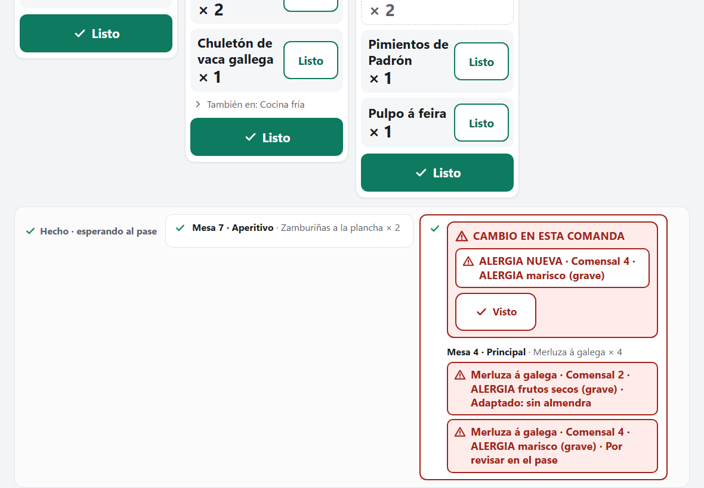

# F0.1 — Alergias I: una alergia tardía o la decisión del pase, con sonido y marca en cocina

Fecha: 2026-11-03. Rama `fix/f0-1-alergias-i-aviso-en-cocina`, sacada de `develop` `81e3f9e` (plan por fases aprobado, PR #107). Es el corte **0.1** de la F0 del plan `docs/plans/2026-11-03-plan-por-fases.md`, con permiso del promotor para la F0 entera («adelante», 03-11). Cierra el hallazgo **H34** (alta) de la evaluación de usabilidad del 28-10, del que C3e.1 solo había hecho la parte de texto. Versión **`0.47.0-f0.1`**. **Sin cambio de esquema** (sigue la v8), **de motor, del contrato HTTP, de la CSP ni de la CI**: solo cambia Costiña Cocina.

## Lo que notará el promotor

Hasta ahora la tablet de cocina solo sonaba cuando entraba una comanda nueva. Si el camarero anotaba una alergia con el pase ya en cocina, o el pase decidía «Adaptado: sin almendra» sobre un plato que el cocinero ya había leído, solo cambiaba el texto dentro de la tarjeta, sin sonido ni marca: la estación podía cocinar con el alérgeno sin que nadie se lo dijera.

- **La comanda queda marcada.** Cuando cambia algo de una comanda que la tablet ya había leído, la tarjeta se pone con borde rojo y, arriba, un recuadro «Cambio en esta comanda» con cada cambio escrito entero:
  - «ALERGIA NUEVA · Comensal 1 · ALERGIA marisco (grave)» (también «INTOLERANCIA NUEVA …» o «PREFERENCIA NUEVA …»);
  - «RETIRADA · …» si Sala la retira, y «CAMBIO · …» si cambia el tipo, la sustancia o la gravedad;
  - en una estación, «DECISIÓN DEL PASE · Merluza · Comensal 2 · ALERGIA frutos secos (grave) · Adaptado: sin almendra».
- **Suena un tono distinto**: tres notas, más graves que las dos de una comanda nueva, después de «Empezar turno», como siempre.
- **También en «Hecho · esperando al pase»**, que es donde más importa: el plato ya está hecho y es el pase quien decide si se rehace.
- **«Visto» quita la marca** en esa tablet, sin mandar nada. Otra tablet de la misma estación la sigue viendo hasta su propio «Visto». Si llega otro cambio con la marca puesta, se añade su línea y vuelve a sonar.
- **El pase ve marcadas las alergias nuevas** de sus comandas, junto al formulario de revisión de siempre. Sus propias decisiones no se avisan a sí mismo.
- **Nada cambia en lo que se puede hacer:** «Listo» sigue como estaba (tu respuesta 5a del 29-10) y decidir sigue siendo solo del pase. Una preferencia leve marca en ámbar, no en rojo.

## Por qué

El freno final ya existía (no se valida ni se sirve sin decisión), pero nada avisaba a la estación entre medias. La evaluación del 28-10 lo puso como el primero de los cinco hallazgos altos y la recapitulación del 02-11 lo dejó como lo único que había que programar antes del primer servicio real. La regla del informe manda: cualquier alergia que pueda pasar desapercibida se arregla antes de abrir.

## Qué cambia

- **`cocina.ts`** (sin DOM):
  - `alertSources(entries, station)`: lo que vigila cada pantalla. Una estación, sus comandas por hacer y las de «Hecho» (`stationTickets`), con solo sus elaboraciones y con las decisiones; el pase (o una tablet sin estación), sus comandas (`passTickets`), sin decisiones, y marcando como «de vuelta» (`reviewing`) un pase ya validado que vuelve por una alergia tardía.
  - `AlertWatch`, como `ReadyWatch` de Sala: tras cada lectura correcta compara, por comanda, cada restricción entera (por su id) y, en una estación, la decisión de cada elaboración, con la lectura anterior. Devuelve las marcas que nacen o crecen en esa lectura (para el sonido); `shown` son las puestas; `dismiss` es «Visto». La primera lectura no avisa; una comanda nueva tampoco (ya suena como nueva), salvo en el pase el pase validado que vuelve. Una línea repetida no vuelve a sonar.
  - Las palabras: `NEW_WORD` («NUEVA», detrás del tipo en mayúsculas), `REMOVED_WORD` («RETIRADA»), `CHANGED_WORD` («CAMBIO») y `DECISION_WORD` («DECISIÓN DEL PASE»). Las líneas usan `restrictionLabel` y `exceptionLine`, las de siempre.
- **`turno.ts`**: `ALARM` (659,25 Hz dos veces y 987,77 Hz; 0,72 s en total) y `alarm(audio)`, con el mismo `play` que `chime`; `Shift.alert()` con las mismas condiciones que `ring()` (turno empezado y audio).
- **`KitchenView.vue`**: tras cada lectura, `AlertWatch` lee `alertSources`; con un cambio suena `shift.alert()`, y si no, con una comanda nueva, `shift.ring()` (con las dos cosas a la vez suena el cambio, que es lo urgente). `alertOf(key)` y `visto(key)`. La marca va en los tres sitios: la rejilla, cada fila de «Hecho» y cada comanda del pase; la tarjeta marcada lleva la clase `alerted`.
- **`AlertBand.vue`**, nuevo: el recuadro (`role="alert"`, `alert-<mesa>-<pase>`) con el título, las líneas con su tono y el único botón, «Visto» (`do-visto-<mesa>-<pase>`), que solo avisa a la vista. Ninguna orden sale de aquí.
- **`style.css`**: `.k-alert` (rojo; `.warn` en ámbar si nada alarma), `.k-alert-t`, `.k-alert-l`, `.k-visto` (64 px) y `.alerted` en la tarjeta, la fila de «Hecho» y la comanda del pase.
- **Versión** `0.47.0-f0.1` en los dos csproj, `package.json` y su lock, y en el diagnóstico simulado de DesktopChecks.

## Capturas

Sale de `e2e/captures-c3d.spec.ts`, contra el motor real y con `C3D_CAPTURES`. Después de «Hecho», Sala anota una alergia grave del comensal 4 en la Mesa 4, cuyo pase la caliente ya había terminado; luego el pase la decide por API («No le afecta», otra marca y otro «Visto») para que la Mesa 4 siga pudiéndose validar en las capturas del pase. Retirarla no vale: la revisión pendiente no se cierra sola. Solo se guarda la captura nueva, en `docs/native/images/f0.1/`.

**La fila de «Hecho» marcada** (1180 × 820): la Mesa 4 · Principal con borde rojo y, encima, «Cambio en esta comanda» con «ALERGIA NUEVA · Comensal 4 · ALERGIA marisco (grave)» y «Visto»; debajo siguen la merluza y la alergia adaptada del comensal 2.

## Qué NO cambia

- El motor, la API, el esquema, la CSP y la CI. Ninguna orden nueva: «Visto» no viaja.
- Costiña Sala y el PC.
- «Listo» con una revisión pendiente (5a del 29-10) y «Adaptado» con el plato ya hecho (5c del 02-11, que va en «Pase con carga»).
- El sonido de una comanda nueva y «Empezar turno».

## Comprobaciones automáticas

En este PC, el 03-11, con `0.47.0-f0.1`:

- **vitest: 618 en 23 ficheros** (609 en C3e.2). `npm run typecheck` y `npm run build`, en verde.
  - `cocina.test.ts`: lo que vigila cada pantalla; la primera lectura no marca; la alergia nueva marca y suena una vez; la decisión del pase añade su línea a la marca de la estación (y el pase no se avisa a sí mismo); una decisión que vuelve a quedar por revisar no se escribe como decisión; retirada y cambio; la preferencia en ámbar; «Visto», la comanda que se va y la comanda nueva que no es un cambio; el pase validado que vuelve.
  - `turno.test.ts`: tres notas, por debajo del segundo, distintas de las dos de la comanda nueva, al mismo volumen; `Shift.alert` solo con el turno empezado y audio.
  - `views.test.ts`: la banda en los tres sitios, `role="alert"`, «Visto» como único botón y sin red, el orden del sonido en el script, y el CSS (64 px, rojo y ámbar).
- **ClientChecks 288**, **dominio 97/97**, **las 14 suites HTTP** (`pwa_http` 8 en 205 s) y **Realtime 13**, con `exit 0` de la batería completa (`.lab-test/f01-battery.log`).
- **Playwright: 31 de 31 contra el motor real, en 3,3 min** (`kitchen.spec`, 11,7 s). `kitchen.spec` añade, en el paso 4, la alergia tardía: la fila de «Hecho» marcada con la alergia escrita entera, 3 notas más (7 en total), «Visto» de 64 px que quita la marca sin subir la versión de la mesa, la alergia que sigue escrita, y el pase marcado también (sin sonido, porque no empezó el turno); en el paso 5, la decisión del pase marcada en la estación («DECISIÓN DEL PASE · Preparación fría · … · Adaptado: sin marisco, salsa aparte»), 3 notas más (10) y «Visto». Al final, 10 notas en vez de 4.
- **DesktopChecks: «WPF startup and viewmodel checks passed»** a la primera, con la versión nueva en el diagnóstico simulado.

## Guion para el promotor (laboratorio)

1. En la tablet de una estación, toca «Empezar turno». En el móvil abre una mesa de 2 sin alergias y envía el primer pase: suena (dos notas) y llega la comanda.
2. Toca «Listo»: baja a «Hecho · esperando al pase».
3. En el móvil, en esa mesa, anota «ALERGIA marisco (grave)» al comensal 1: la tablet suena distinto (tres notas) y la fila de «Hecho» se pone con borde rojo y «ALERGIA NUEVA · Comensal 1 · ALERGIA marisco (grave)».
4. Toca «Visto»: la marca se va; la alergia sigue escrita en la fila.
5. En la tablet del pase decide «Adaptado» con una nota: la estación vuelve a sonar y marca «DECISIÓN DEL PASE · … · Adaptado: …». «Visto».

## Decisiones pequeñas

Cualquiera se cambia si el promotor lo prefiere:
1. El título del recuadro es «Cambio en esta comanda»; cada línea lleva delante lo que pasó (NUEVA, RETIRADA, CAMBIO, DECISIÓN DEL PASE).
2. «Visto» es de cada tablet y solo en memoria: una recarga quita las marcas (lo que está, se lee escrito).
3. Con una comanda nueva y un cambio en la misma lectura suena solo el cambio.
4. El pase no se avisa de sus propias decisiones; sí de las alergias nuevas, retiradas o cambiadas.
5. Una preferencia o intolerancia leve marca en ámbar; el resto, en rojo.
6. El tono: tres notas (mi, mi, si), por debajo del segundo.

## Límites y diferido

- La estación sigue pudiendo marcar «Listo» con una revisión pendiente, y «Adaptado» con el plato ya hecho sigue sin devolverlo a la estación: son las decisiones 5a (29-10) y 5c (02-11), que van en «Pase con carga» (F8).
- Sin «Empezar turno» no hay sonido, como con las comandas nuevas; la marca sí se ve.
- Una tablet cuya página estaba cerrada no sabe qué cambió mientras tanto: al abrir lo lee todo escrito, sin marcas.
- «Sala: avisos que se ven» (sonido y marca en el móvil del camarero, H18, H23, H24) sigue en la F8.

## Vuelta atrás

F0.1 no cambia los datos ni hay que emparejar de nuevo ningún aparato. Pero, desde E4e, el instalador no deja bajar de versión: volver a `0.46.2-c3e.2` es restaurar la copia previa a la actualización, en un equipo limpio y con el instalador anterior.
