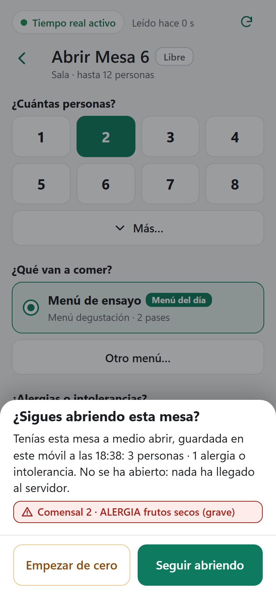
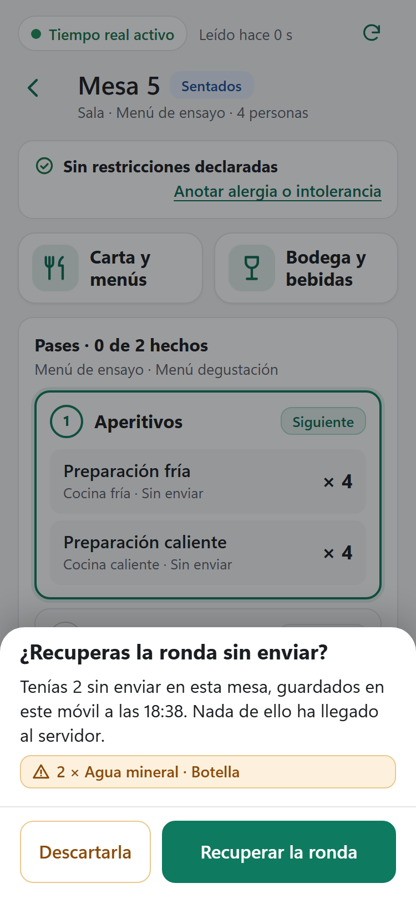

# F0.2 — Alergias II: la ronda y la mesa a medio abrir se guardan en el móvil, y «Atrás» baja un nivel

Fecha: 2026-11-03. Rama `fix/f0-2-alergias-ii-borrador-en-el-movil`, sacada de `develop` `6f162ca` (F0.1 mezclada, PR #108). Es el corte **0.2** de la F0 del plan `docs/plans/2026-11-03-plan-por-fases.md`, con el permiso del promotor para la F0 entera («adelante», 03-11). Cierra el hallazgo **H01** (alta) de la evaluación de usabilidad del 28-10 con la decisión **8b** del 02-11: «la ronda sin enviar y la mesa a medio abrir se guardan en ese móvil hasta enviarlas o descartarlas; al volver se pregunta». Versión **`0.47.1-f0.2`**. **Sin cambio de esquema** (sigue la v8), **de motor, del contrato HTTP, de la CSP ni de la CI**: solo cambia Costiña Sala (y una línea de CSS común).

## Lo que notará el promotor

Hasta ahora, la ronda de Bodega y las alergias escritas en «Abrir mesa» vivían solo en memoria: el «Atrás» de Android salía de la aplicación, tirar de la pantalla hacia abajo la recargaba, y en los dos casos se perdían sin preguntar. Si el camarero reabría la mesa sin acordarse de la alergia, la mesa salía sin ella.

- **Lo escrito se guarda en ese móvil.** La ronda con líneas y la hoja de abrir con algo tocado (personas, menú o alergias) se guardan en el propio móvil con cada cambio, y se borran al enviar la ronda, al abrir la mesa, con «Salir sin enviar» o «Salir sin abrir», o al quedar vacías.
- **Al volver se pregunta; nada vuelve solo.** Al entrar en una mesa con una ronda guardada: «¿Recuperas la ronda sin enviar?», con «Tenías 2 sin enviar en esta mesa, guardados en este móvil a las 21:14. Nada de ello ha llegado al servidor.», cada línea escrita, y «Recuperar la ronda» (la opción segura, con el foco) o «Descartarla». Al tocar una mesa libre con una hoja guardada: «¿Sigues abriendo esta mesa?», con «3 personas · Menú del día · 1 alergia o intolerancia» y las alergias enteras, y «Seguir abriendo» o «Empezar de cero».
- **«Atrás» del sistema baja un nivel**, en vez de salir: de Carta o Bodega a la ficha, y de la ficha o de «Abrir mesa» al plano. Con una ronda o una alergia sin enviar hace **la misma pregunta que «Mesas»**; «Seguir con la ronda» o «Seguir abriendo» dejan todo como estaba.
- **Tirar de la pantalla hacia abajo ya no recarga** la página (Costiña Sala y Costiña Cocina).
- La bandeja de la ronda ya no dice «Si la página se recarga, la ronda se pierde», sino «Se guarda en este móvil hasta enviarla o descartarla».
- **Nada de esto envía nada.** Lo guardado nunca es una orden ni una cola: la orden sale solo cuando el camarero toca «Enviar ronda» o «Abrir», como siempre, con la versión leída de la mesa (F01).

## Por qué

La evaluación del 28-10 lo puso entre los cinco hallazgos altos: la única salida de la ficha era la flecha de arriba, el «Atrás» de Android salía de la aplicación y, con la conexión sencilla, tirar hacia abajo recargaba; en los dos casos se perdía lo escrito sin preguntar. La recapitulación del 02-11 lo dejó, con H34, como lo que había que arreglar antes del primer servicio real, y el promotor decidió el 02-11 guardar el borrador en el aparato (8b).

## Qué cambia

- **`borrador.ts`**, nuevo: el único módulo que guarda. `saveRoundDraft` / `loadRoundDraft` / `clearRoundDraft` por servicio y `saveOpenDraft` / `loadOpenDraft` / `clearOpenDraft` por mesa, en la base IndexedDB de Costiña Sala (`db.ts`), en el almacén `pending` con claves propias (`draft:round:<servicio>`, `draft:open:<mesa>`): el hueco único de la orden incierta (`uncertain`, `pending.ts`) no se toca y la adopción solo lee ese hueco; sin cambio de versión de la base. Se guardan copias planas. Al leer, **fallo cerrado** (`parseRoundDraft`, `parseOpenDraft`): otra mesa, otro tipo, una cantidad o un comensal fuera de rango, un tipo o una gravedad que el servidor no conoce, cuentan como nada guardado. Y las palabras de la pregunta (`recoverRoundText`, `recoverRoundLines`, `recoverOpenText`, `RECOVER_*`).
- **`round.ts`**: `restore(lines)`, solo con la ronda vacía y sin orden en curso; copia las líneas. `round.ts` y `abrir.ts` siguen sin importar nada que persista (sus pruebas lo exigen).
- **`atras.ts`**, nuevo, sin DOM: `BackStack`. Cada nivel que la pantalla abre deja una entrada en el historial (`enter`); cerrarlo desde la pantalla la consume (`exit`, con `history.back()` cuyo `popstate` se ignora); un `popstate` de la persona es nuestro mientras haya niveles (`pop`); si el nivel de arriba pregunta antes de cerrarse, la entrada se repone (`keep`). La dirección no cambia nunca.
- **`RecoverSheet.vue`**, nuevo: la hoja de la pregunta (`<id>-sheet`, `-text`, `-yes`, `-no`), con el aspecto de «¿Salir sin enviar la ronda?»; el botón de recuperar es el principal y recibe el foco; el velo no cierra; ninguna orden sale de aquí.
- **`TableCard.vue`**: al montar la ficha lee la ronda guardada de ese servicio y, si la ronda está vacía, pregunta; cada cambio de la ronda la guarda entera o la borra (un `watch` síncrono); «Descartarla» y «Salir sin enviar» la borran explícitamente; `leave` devuelve si preguntó.
  - **Trampa de Vue encontrada en la batería:** «Salir sin enviar» vacía la ronda y sale en el mismo ciclo; el padre se actualiza antes que el hijo y desmonta la ficha, y Vue descarta el `watch` pendiente que iba a borrar lo guardado. Por eso el borrado va también en el propio descarte.
- **`OpenTable.vue`**: al montar lee lo guardado de esa mesa y, si la hoja está como nueva, pregunta; cada cambio guarda personas (si se tocaron), menú (si se eligió) y filas, o lo borra si la hoja vuelve a estar como nueva; «Empezar de cero» y «Salir sin abrir» lo borran; un menú guardado que ya no se ofrece no se recupera (la hoja propone el de hoy); `leave` devuelve si preguntó.
- **`BoardView.vue`**: los niveles abiertos son lo que se ve (la ficha, su panel de Carta o Bodega y la hoja de abrir); un `watch` **síncrono** los traduce a `enter`/`exit`; el `popstate` cierra el de arriba (`closeTop`) y repone la entrada si preguntó. Con la apertura confirmada o sin confirmar borra lo guardado de esa mesa (las filas ya viajan en la orden).
- **`bodega.ts`**: `ROUND_HINT`. **`style.css`**: `overscroll-behavior-y: none` en `html, body`. **`db.ts`**: el comentario de las claves.
- **Versión** `0.47.1-f0.2` en los dos csproj, `package.json` y su lock, y en el diagnóstico simulado de DesktopChecks.

## Capturas

Salen de `e2e/captures-f02.spec.ts`, contra el motor real y con `F02_CAPTURES` (`playwright.config.ts` corre entonces solo ese spec), en el móvil de 375 × 812, las dos tras recargar la página.

**La mesa a medio abrir** (375 × 812): al tocar otra vez la Mesa 6, «¿Sigues abriendo esta mesa?», «Tenías esta mesa a medio abrir, guardada en este móvil a las 18:38: 3 personas · 1 alergia o intolerancia. No se ha abierto: nada ha llegado al servidor.» (el menú no se nombra porque no se tocó: la hoja propone el del día y solo se guarda lo elegido), la alergia en rojo y «Empezar de cero» / «Seguir abriendo».

**La ronda guardada** (375 × 812): al entrar en la Mesa 5, «¿Recuperas la ronda sin enviar?», «Tenías 2 sin enviar en esta mesa, guardados en este móvil a las …», «2 × Agua · Botella» y «Descartarla» / «Recuperar la ronda».

## Qué NO cambia

- El motor, la API, el esquema, la CSP y la CI. Ninguna orden nueva; lo guardado nunca viaja solo.
- La orden incierta (D6.3, D6.7): su hueco, su clave y su conciliación siguen igual. Un borrador no es una orden.
- Costiña Cocina y el PC (solo les llega la línea de CSS).
- Las preguntas de «Mesas» («¿Salir sin enviar la ronda?», «¿Salir sin abrir la mesa?») y lo que hacen: «Salir sin enviar» y «Salir sin abrir» siguen siendo descartar.

## Comprobaciones automáticas

En este PC, el 03-11, con `0.47.1-f0.2`:

- **vitest: 637 en 25 ficheros** (618 en F0.1). `npm run typecheck` y `npm run build`, en verde.
  - `borrador.test.ts`, nuevo: la lectura con fallo cerrado de la ronda y de la hoja (otra mesa, otro tipo, cantidades y comensales fuera de rango, tipos y gravedades desconocidos, más de 30 líneas o filas, nada a medio abrir); el almacén con `fake-indexeddb` (guardar, leer, sobrescribir, borrar, copia plana, y que el hueco `uncertain` y la credencial quedan como estaban); las palabras de las dos preguntas; y que `borrador.ts` es el único que persiste y no toca la red ni la orden incierta.
  - `atras.test.ts`, nuevo: `enter`/`exit` con el `popstate` ignorado, los `pop` nuestros y los de nadie, `keep` y su consumo al confirmar, cierres y «Atrás» entrelazados, y que el historial del navegador recibe nuestra marca sin dirección.
  - `drinks.test.ts`: `Round.restore` (copia, limpia el aviso anterior; se niega con líneas o con una orden en curso; nunca más del tope). La prueba de que `round.ts` no persiste sigue.
  - `views.test.ts`: la hoja de recuperar (dos botones, el seguro con el foco, el velo no cierra, sin órdenes), la ficha y la hoja de abrir (pregunta, recuperación solo con «sí», guardar o borrar con cada cambio, descartar), el historial (`BackStack`, el `watch` síncrono, `keep` al preguntar, `popstate`), el CSS y el texto de la bandeja.
- **ClientChecks 288**, **dominio 97/97**, **las 14 suites HTTP** (`pwa_http` 8 en 204 s) y **Realtime 13**, con `exit 0` de la batería completa (`.lab-test/f02-battery-3.log`; las dos anteriores fallaron solo en `drinks.spec`, por lo de arriba y por el borrado al descartar).
- **Playwright: 31 de 31 contra el motor real, en 3,3 min.**
  - `drinks.spec`: en el paso 4, la recarga que ya hacía con un agua sin enviar la encuentra ahora guardada y la pregunta sale al entrar en la mesa (la hoja es modal: la primera batería se quedó esperando detrás del velo hasta agotar el tiempo; la prueba decide «Descartarla»). Y añade el paso 8: la ronda guardada (leída de IndexedDB), la recarga, la pregunta con la línea entera y el foco en «Recuperar la ronda», la ronda recuperada sin enviar nada, `goBack()` con la misma pregunta que «Mesas», «Seguir con la ronda», y «Salir sin enviar» que descarta lo guardado (al volver a entrar, nada que recuperar).
  - `mesas.spec`: «Salir sin abrir» descarta lo guardado; con la alergia escrita, la recarga, la pregunta con personas, alergia y el foco en «Seguir abriendo», la hoja recuperada entera (personas, comensal, sustancia, la línea sobre «Abrir»), `goBack()` con «¿Salir sin abrir la mesa?» y «Seguir abriendo»; y, abierta la mesa, lo guardado se borra.
- **DesktopChecks: «WPF startup and viewmodel checks passed»** a la primera, con la versión nueva en el diagnóstico simulado.

## Guion para el promotor (laboratorio)

1. En el móvil, toca una mesa libre, elige 3 personas y anota una alergia. Tira de la pantalla hacia abajo: no se recarga. Pulsa el «Atrás» de Android: «¿Salir sin abrir la mesa?»; «Seguir abriendo».
2. Cierra la aplicación del todo y vuelve a abrirla. Toca la misma mesa: «¿Sigues abriendo esta mesa?» con tu alergia; «Seguir abriendo» la devuelve. «Abrir».
3. En esa mesa, entra en Bodega y añade dos copas. Cierra la aplicación y vuelve: «¿Recuperas la ronda sin enviar?»; «Recuperar la ronda» y «Enviar ronda».
4. Otra vez en Bodega, añade una copa y pulsa «Atrás» del sistema dos veces: primero vuelve a la ficha; después pregunta «¿Salir sin enviar la ronda?». «Salir sin enviar»: al volver a la mesa no hay nada que recuperar.

## Decisiones pequeñas

Cualquiera se cambia si el promotor lo prefiere:
1. Al volver siempre se pregunta (8b); el botón de recuperar es el seguro y recibe el foco; el velo no cierra la pregunta.
2. «Salir sin enviar» y «Salir sin abrir» siguen siendo descartar: borran lo guardado.
3. Un menú guardado que ya no se ofrece no se recupera; las personas y las alergias sí.
4. «Atrás» desde Carta o Bodega vuelve a la ficha sin preguntar (la ronda sigue en la ficha); desde la ficha o la hoja pregunta como «Mesas».
5. Lo guardado es de ese móvil: otro móvil no lo ve.
6. Tras una recarga, las entradas del historial que quedaran no hacen nada visible hasta agotarse.

## Límites y diferido

- Una ronda guardada de una mesa que otro puesto cerró se pierde con la mesa (la ficha ya no existe); una hoja guardada de una mesa que otro abrió espera a que vuelva a estar libre.
- El borrador no se guarda con la ronda de camino al servidor: si la orden queda sin confirmar, ya es la orden incierta (D6.7), no un borrador.
- «Sala: avisos que se ven» (píldora fija, sonido opcional, H18, H23, H24, H14) sigue en la F8.

## Vuelta atrás

F0.2 no cambia los datos del servidor ni hay que emparejar de nuevo ningún aparato. Un móvil con una versión anterior ignora los borradores guardados (claves que no lee nadie). Desde E4e, el instalador no deja bajar de versión: volver a `0.47.0-f0.1` es restaurar la copia previa a la actualización, en un equipo limpio.
